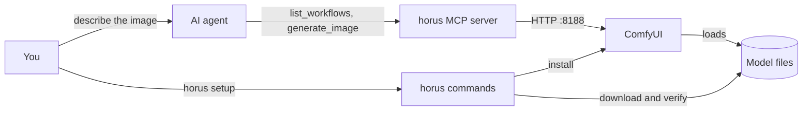
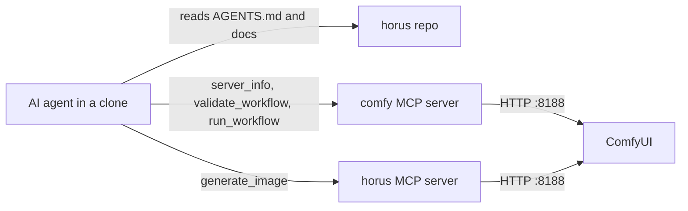

# horus

Get your first image from a local AI model, with an AI agent at the controls.

horus is a starter kit for engineers who are new to local image generation.
It installs [ComfyUI](https://github.com/comfyanonymous/ComfyUI) on a Windows PC
with an NVIDIA GPU or on a Mac with Apple Silicon, downloads one verified model set (FLUX 3 Image Klein), and
gives an AI agent (Claude Code or Codex) one image tool: the horus MCP server.

You describe the image. The agent picks a workflow, writes the subject and
calls `generate_image`. horus runs the job on your ComfyUI and returns the path
of the PNG. The agent never sees ComfyUI.

A new style needs a new workflow. An agent makes it in a clone of this repo,
with the rules of this repo and the comfy MCP server (see
[Work on this repo](#work-on-this-repo-developers)).

## Install horus

horus is one program. You install it with one line. The line downloads the
program from the newest [GitHub Release](https://github.com/hieplam/horus/releases),
checks its SHA-256, and puts it on your PATH. SHA-256 is a hash of the file. A
download that does not match the hash is never installed. You need no clone of
this repo, no Go and no Python for this step.

On Windows 10 or 11 (64-bit), open PowerShell and run:

```
irm https://raw.githubusercontent.com/hieplam/horus/main/install.ps1 | iex
```

On macOS with Apple Silicon, open Terminal and run:

```
curl -fsSL https://raw.githubusercontent.com/hieplam/horus/main/install.sh | sh
```

The script puts the program here:

| System | Program file | PATH |
|---|---|---|
| Windows | `%LOCALAPPDATA%\Programs\horus\horus.exe` | The script adds the folder to the PATH of your user account. |
| macOS | `~/.local/bin/horus` | The script adds one marked line to your shell profile when the folder is not on the PATH. |

Open a new terminal after the install, so that the new PATH is read. To update,
run the same line again. The script replaces the program. It sends no token and
reads no secret.

**Settings.** Set an environment variable before the line to change a default.
`HORUS_VERSION` picks a release, for example `0.1.0`. The default is the newest
release. `HORUS_INSTALL_DIR` picks the folder of the program.
`HORUS_INSTALL_NO_PATH=1` leaves the PATH unchanged.

**Install by hand.** Use these steps when you do not want to run a script from the
internet. There are three: download the program, check its SHA-256, and put it on
the PATH. Do the steps of your system.

On Windows, in PowerShell, download the program and the list of hashes:

```
Invoke-WebRequest https://github.com/hieplam/horus/releases/latest/download/horus-windows-amd64.exe -OutFile horus.exe
Invoke-WebRequest https://github.com/hieplam/horus/releases/latest/download/checksums.txt -OutFile checksums.txt
```

Print the SHA-256 of your download, then the line of `checksums.txt` for the same
file. The two hashes must be equal, letter for letter. If they differ, delete
`horus.exe` and do not run it.

```
(Get-FileHash horus.exe -Algorithm SHA256).Hash
Select-String horus-windows-amd64.exe checksums.txt
```

Move the program to its folder, then add the folder to the PATH of your user account:

```
New-Item -ItemType Directory -Force "$env:LOCALAPPDATA\Programs\horus"
Move-Item horus.exe "$env:LOCALAPPDATA\Programs\horus\horus.exe" -Force
[Environment]::SetEnvironmentVariable('Path', [Environment]::GetEnvironmentVariable('Path', 'User') + ";$env:LOCALAPPDATA\Programs\horus", 'User')
```

On macOS, in Terminal, download the program and the list of hashes:

```
curl -fsSLO https://github.com/hieplam/horus/releases/latest/download/horus-darwin-arm64
curl -fsSLO https://github.com/hieplam/horus/releases/latest/download/checksums.txt
```

Print the SHA-256 of your download, then the line of `checksums.txt` for the same
file. The two hashes must be equal. If they differ, delete `horus-darwin-arm64` and
do not run it.

```
shasum -a 256 horus-darwin-arm64
grep horus-darwin-arm64 checksums.txt
```

Make the file a program, move it to its folder, and add the folder to the PATH:

```
chmod +x horus-darwin-arm64
mkdir -p "$HOME/.local/bin"
mv horus-darwin-arm64 "$HOME/.local/bin/horus"
echo 'export PATH="$HOME/.local/bin:$PATH"' >> ~/.zshrc
```

**If it fails.**

- `horus` is "not recognized" or "command not found": open a new terminal. The old terminal has the old PATH.
- The script says that the SHA-256 is wrong: the download is damaged or changed. The script installed nothing. Run the line again. If it fails again, do not use the program.
- The script says that it cannot download: the release does not exist or the network is down. Check [the releases page](https://github.com/hieplam/horus/releases).

## Check the install and see the plan

```
horus version
horus setup it-illustration
```

`horus version` prints one line: `horus <version>`. If it prints an error, the
program is not on the PATH (see "If it fails" above).

`horus setup <workflow>` prints a plan and changes nothing. The plan lists each
model file of the workflow (`PRESENT` or `MISSING`) and each step that the
machine still needs: a system package, ComfyUI, the model files. The next section
runs the plan.

## The parts

| Part | What it is |
|---|---|
| ComfyUI | The program that runs image models on your GPU. A job is a graph of nodes, called a workflow. |
| horus MCP server | The image tool for agents, started as `horus mcp`. MCP (Model Context Protocol) is the standard way an agent calls tools. The tools: `list_workflows`, `describe_workflow`, `install_workflow`, `uninstall_workflow`, `generate_image`. The caller names a workflow and a subject and gets a PNG path. horus adds no style: the caller writes the look in the subject. The caller never sees ComfyUI. See [`docs/mcp.md`](docs/mcp.md). |
| horus commands | The commands that you run: `horus setup`, `horus doctor`, `horus register`, `horus uninstall`. The horus MCP server and the commands are one program, `horus`. |
| comfy MCP server | A separate program with low-level ComfyUI tools such as `validate_workflow` and `run_workflow`. Only an agent in a clone of this repo uses it, to build and debug a workflow. |
| This repo | The rules, the Go code of the `horus` program, the workflows and the saved prompts. An agent reads it when it changes horus or makes a new workflow. To make images you need no clone: the program holds the workflows. |
| Model files | Gigabytes of weights on disk. Never in git. Each file is checked by SHA-256. |



The agent talks only to the horus MCP server. The horus MCP server sends HTTP
requests to ComfyUI. The comfy MCP server is not on this path. The agent can
also download the model files with the tool `install_workflow`, after you agree.

## Set up the machine

Run the plan with `-yes`. This installs ComfyUI first, then downloads the model
files (11 GB for `it-illustration`).

```
horus setup it-illustration -yes
```

Two things can stop it before it changes anything.

- **A system package.** A new machine can lack a program that ComfyUI needs: 7-Zip on Windows (installed with `winget`) or Python 3.12 on macOS (installed with `brew`). horus never installs a system package without your approval. Without it, `horus setup it-illustration -yes` prints the package and its command, changes nothing and exits 1. To approve the package, add `-with-packages`. Or install the package yourself, then run the command again. If `winget` or `brew` is missing, the plan says what to install and where to get it.
- **The Hugging Face token.** The model files need the FLUX Kommunity License and a token. Write the token as `HF_TOKEN=<your token>` in the file `.env` of the user folder: `%USERPROFILE%\horus\.env` on Windows, `~/horus/.env` on macOS. [Setup step 1](docs/setup.md#step-1-put-your-hugging-face-token-in-env) shows how to get the token. Without it, the download stops with HTTP 401 or 403.

To approve the package step too, run:

```
horus setup it-illustration -yes -with-packages
```

Every command is safe to run again. A second run prints `Plan: 0 steps. Nothing is missing.`
An agent can do the same setup through the tool `install_workflow`. The tool asks
you before it installs a package (`accept_setup`) and before it downloads the model
files (`accept_license`). See [`docs/mcp.md`](docs/mcp.md).

Then give the horus tools to your agent. This registers the server `horus` with
Claude Code.

```
horus register
```

To register it with Codex, run `horus register -client codex`. After this, an agent
in any folder of your PC has the tools `list_workflows`, `describe_workflow`,
`install_workflow`, `uninstall_workflow` and `generate_image`. Check the machine at
any time with `horus doctor`.

## Uninstall

`horus uninstall` prints what horus installed on this machine and changes nothing.
Each line starts with `REMOVE` or `KEEP`, then the path and the reason.

```
horus uninstall
```

`horus uninstall -yes` removes each `REMOVE` item. Read the plan first, because
nobody can undo the removal.

```
horus uninstall -yes
```

What `-yes` removes:

- **The model files of the workflows.** This includes a model file that a person downloaded by hand, when its size matches `models.json`. A file with another size stays.
- **The ComfyUI folder and the venv of comfy-cli and the comfy MCP server.** Only a folder that horus installed. horus writes a file `horus-install.json` into each folder that it makes, and it deletes a folder only when that file is there. A ComfyUI that you installed yourself, or that an older horus installed, stays. A ComfyUI that answers and that horus did not start stays too.
- **The registration** of the server `horus` in Claude Code and in Codex.
- **The copy of the built-in workflows** and the state files of horus in the user folder.
- **The PATH entry of the install script, and the program itself.** The program is the last item.

What it keeps: `.env` (your token) and `outputs/` (your images), because they are your
data. The plan names both paths. A system package (7-Zip, Python) stays: horus never
removes a system package. A PATH entry that you added by hand stays: remove it yourself.

`horus uninstall -models` limits the command to the model files. `horus uninstall -mcp`
limits it to the registration.

## Next steps

1. **Make your first image.** Start the agent in any folder and ask for "a flat
   vector illustration of a message queue". The agent calls `generate_image` and
   gives you the path of the PNG. [`workflows/it-illustration`](workflows/it-illustration/README.md)
   shows how to write the subject. Without an agent, run
   `horus run-illustration -subject "..."`.
2. **Make your own style:** [`docs/style-to-workflow.md`](docs/style-to-workflow.md).
   How an agent in a clone goes from one sentence to a tested, saved workflow.
3. **Every step in detail:** [`docs/setup.md`](docs/setup.md).

New to the words? Read [`docs/concepts.md`](docs/concepts.md) first.

## Work on this repo (developers)

This section is for people who change the code of horus. A user who only wants
images needs the install line above. Claude Code starts each MCP server itself,
as a child program (a stdio server). The full setup is [`docs/setup.md`](docs/setup.md).

In a clone, the file `.mcp.json` gives the agent two servers. The comfy MCP
server is the low-level tool to build, check and debug a workflow. The horus MCP
server is the same image tool that a user's agent gets. Both servers send HTTP
requests to the same ComfyUI.



1. Install Go 1.27.3 or newer, Python 3.12 and Claude Code. On Windows, Python
   needs the Python Launcher. On macOS, `brew install python@3.12 go uv` installs
   Python and Go.
2. Clone this repo and open a terminal in its root folder.
3. Build `horus`, then install the comfy MCP server. `go install` puts `horus` in
   `%USERPROFILE%\go\bin` (`~/go/bin` on macOS). That folder must be
   on the PATH, because `.mcp.json` starts both servers through `horus`
   ([how](docs/setup.md#build-horus)).

   ```
   go install ./cmd/horus
   horus install-comfy-mcp
   ```

4. Check the machine. No line may show `FAIL`. On macOS, a `WARN` line names a
   path in a folder that macOS protects ([why](docs/setup.md#the-macos-privacy-folders)).

   ```
   horus doctor
   ```

   To see what a workflow still needs, run `horus setup it-illustration`. It
   prints the plan and changes nothing. `horus setup it-illustration -yes` runs
   the plan: ComfyUI first, then the model files. `horus stop-comfyui` stops a
   ComfyUI that horus started. The older command names (`check-setup`,
   `install-comfyui`, `workflow install`) still work.

5. Start `claude` in this folder. Approve the project servers `comfy-mcp` and `horus`.
6. Type `/mcp`. Both servers must show as connected.

**Where Claude Code finds the servers.**

| Entry | Where | Which sessions see it |
|---|---|---|
| `.mcp.json` (project scope) | this repo, in git | sessions started in this folder, after you approve |
| `claude mcp add --scope user` (user scope), made by `horus register` | your Claude Code user settings | sessions in every folder |

Claude Code reads `.mcp.json` by itself, but it does not build or install the
programs. If you skip step 3, `/mcp` shows the server as failed. An agent in this
repo reads [`AGENTS.md`](AGENTS.md), which tells it to run `horus doctor` and
the install command that a FAIL line names.

## Give other agents an image tool

`horus register` (see "Set up the machine") adds the server `horus` to your agent.
After this, an agent in any folder of your PC (for example a video project
that needs pictures) has the horus tools. It calls `list_workflows`, reads the
rules of a style with `describe_workflow`, and calls `generate_image`. The call
waits until the PNG is on disk and returns its path. Errors have a code, a
`next_step` and `action_by`, so the agent knows if it must retry, change its
call or ask you. Details: [`docs/mcp.md`](docs/mcp.md). Without a clone, the
tools use the workflows that the program holds. In a clone, `horus register` also
sets the variable `HORUS_ROOT` to the clone, so the tools use the workflows of the
clone. You do not set it by hand
([setup step 3](docs/setup.md#step-3-give-the-horus-tools-to-your-agent)).

## What you need

- Windows 10 or 11, NVIDIA GPU with 6 GB VRAM or more, 16 GB RAM, about 20 GB free disk.
- Or macOS on Apple Silicon with 16 GB of memory and about 14 GB free disk.
  Linux and Intel Macs are not supported yet.
- A free Hugging Face account, to accept the model license.
- Python 3.12 on macOS only, for comfy-cli. `horus setup` installs it after you approve it. Windows needs no Python.
- Go 1.27.3 or newer, Git and Python 3.12, only to work on the code of horus (Python for the comfy MCP server).
  The [prerequisites](docs/setup.md#prerequisites) list each item for each system.
- An AI agent CLI: [Claude Code](https://claude.com/claude-code) or Codex.

## Docs

| | |
|---|---|
| [`docs/setup.md`](docs/setup.md) | Flow 1: a fresh machine to a working setup |
| [`docs/style-to-workflow.md`](docs/style-to-workflow.md) | Flow 2: a style description to a tested workflow |
| [`docs/concepts.md`](docs/concepts.md) | Every term, what it does, what breaks if it is wrong |
| [`docs/running-workflows.md`](docs/running-workflows.md) | For developers: the comfy MCP run loop, to build and debug a workflow, and its failure modes |
| [`docs/mcp.md`](docs/mcp.md) | The horus MCP server: tools, result envelope, error codes, long calls |
| [`docs/models.md`](docs/models.md) | The verified model catalog |
| [`docs/why-flux3-klein.md`](docs/why-flux3-klein.md) | Why FLUX 3 Image Klein, what else was tried, small-GPU traps |
| [`ROADMAP.md`](ROADMAP.md) | Where horus goes next |

## Workflows

List them, install the files of one, or remove them with
`horus workflow` (`list`, `install <name>`, `check <name>`, `remove <name>`). See [manage workflows](docs/setup.md#manage-workflows-list-install-check-remove).

| Workflow | Does | Model family |
|---|---|---|
| [`it-illustration`](workflows/it-illustration/README.md) | Text to image, 1536×1024. No style of its own: the caller writes the look. | FLUX 3 Image Klein |

## License

The code and docs in this repo are MIT ([`LICENSE`](LICENSE)). The models have
their own licenses. FLUX 3 Image Klein uses the FLUX Kommunity License, which
you accept on Hugging Face before the download works.
