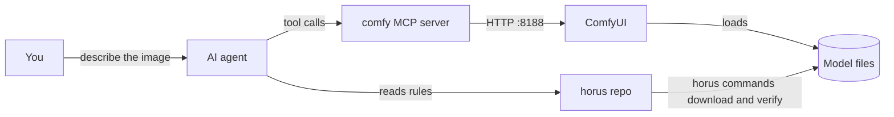

# horus

Get your first image from a local AI model, with an AI agent at the controls.

horus is a starter kit for engineers who are new to local image generation.
It installs [ComfyUI](https://github.com/comfyanonymous/ComfyUI) on a Windows PC
with an NVIDIA GPU or on a Mac with Apple Silicon, downloads one verified model set (FLUX 3 Image Klein), and
gives an AI agent (Claude Code or Codex) the written rules it needs to drive
ComfyUI for you through the comfy MCP server.

You describe the image. The agent reads this repo, builds or changes a
workflow, checks it against your running ComfyUI, runs it, and shows you the
result.

## The parts

| Part | What it is |
|---|---|
| ComfyUI | The program that runs image models on your GPU. A job is a graph of nodes, called a workflow. |
| comfy MCP server | A local process that gives an agent tools such as `validate_workflow` and `run_workflow`. MCP (Model Context Protocol) is the standard way an agent calls tools. |
| horus MCP server | The image tool for other agents: `list_workflows`, `describe_workflow`, `install_workflow`, `uninstall_workflow`, `generate_image`. The caller names a workflow and a subject and gets a PNG path. horus adds no style: the caller writes the look in the subject. It never sees ComfyUI. See [`docs/mcp.md`](docs/mcp.md). |
| This repo | The rules, the Go code of the `horus` program, the workflows and the saved prompts. The agent reads it. You run `horus`. |
| Model files | Gigabytes of weights on disk. Never in git. Each file is checked by SHA-256. |



## Start here

1. **Set up the machine:** [`docs/setup.md`](docs/setup.md). Seven steps, from
   an empty PC or Mac to a test image. Every command is safe to run again.
2. **Make your first image:** [`workflows/it-illustration`](workflows/it-illustration/README.md).
   Ask the agent for "an illustration of a message queue", or run
   `horus run-illustration -subject "..."` without an agent.
3. **Make your own style:** [`docs/style-to-workflow.md`](docs/style-to-workflow.md).
   How the agent goes from one sentence to a tested, saved workflow.

New to the words? Read [`docs/concepts.md`](docs/concepts.md) first.

## Install the MCP servers on a new machine

Claude Code starts each MCP server itself, as a child program (a stdio server).
You only install the programs. The full setup, with ComfyUI and the models, is
[`docs/setup.md`](docs/setup.md).

1. Install Go 1.27.3 or newer, Python 3.12 and Claude Code. On Windows, Python
   needs the Python Launcher. On macOS, `brew install python@3.12 go uv` installs
   Python and Go.
2. Clone this repo and open a terminal in its root folder.
3. Build `horus`, then install the comfy MCP server. `go install` puts `horus` in
   `%USERPROFILE%\go\bin` (`~/go/bin` on macOS). That folder must be
   on the PATH, because `.mcp.json` starts both servers through `horus`
   ([how](docs/setup.md#step-0-get-the-horus-program)).

   ```
   go install ./cmd/horus
   horus install-comfy-mcp
   ```

4. Check the machine. No line may show `FAIL`. On macOS, a `WARN` line names a
   path in a folder that macOS protects ([why](docs/setup.md#the-macos-privacy-folders)).

   ```
   horus doctor
   ```

   To see what a workflow still needs, run `horus setup it-illustration`. It
   prints the plan and changes nothing. `horus setup it-illustration -yes` runs
   the plan: ComfyUI first, then the model files. `horus stop-comfyui` stops a
   ComfyUI that horus started. The older command names (`check-setup`,
   `install-comfyui`, `workflow install`) still work.

5. Start `claude` in this folder. Approve the project servers `comfy-mcp` and `horus`.
6. Type `/mcp`. Both servers must show as connected.

**Where Claude Code finds the servers.**

| Entry | Where | Which sessions see it |
|---|---|---|
| `.mcp.json` (project scope) | this repo, in git | sessions started in this folder, after you approve |
| `claude mcp add --scope user` (user scope), made by `horus register` | your Claude Code user settings | sessions in every folder |

Claude Code reads `.mcp.json` by itself, but it does not build or install the
programs. If you skip step 3, `/mcp` shows the server as failed. An agent in this
repo reads [`AGENTS.md`](AGENTS.md), which tells it to run `horus doctor` and
the install command that a FAIL line names.

## Give other agents an image tool

```
horus register
```

After this, an agent in any folder of your PC (for example a video project
that needs pictures) has the horus tools. It calls `list_workflows`, reads the
rules of a style with `describe_workflow`, and calls `generate_image`. The call
waits until the PNG is on disk and returns its path. Errors have a code, a
`next_step` and `action_by`, so the agent knows if it must retry, change its
call or ask you. Details: [`docs/mcp.md`](docs/mcp.md). `horus register` also sets
the variable `HORUS_ROOT` to the repo folder. You do not set it by hand
([setup step 5](docs/setup.md#optional-the-image-tool-for-agents-in-other-folders)).

## What you need

- Windows 10 or 11, NVIDIA GPU with 6 GB VRAM or more, 16 GB RAM, about 20 GB free disk.
- Or macOS on Apple Silicon with 16 GB of memory and about 14 GB free disk.
  Linux and Intel Macs are not supported yet.
- Git, Go 1.27.3 or newer, Python 3.12 (for the comfy MCP server), and a free Hugging Face account.
  The [prerequisites](docs/setup.md#prerequisites) list each item for each system.
- An AI agent CLI: [Claude Code](https://claude.com/claude-code) or Codex.

## Docs

| | |
|---|---|
| [`docs/setup.md`](docs/setup.md) | Flow 1: a fresh machine to a working setup |
| [`docs/style-to-workflow.md`](docs/style-to-workflow.md) | Flow 2: a style description to a tested workflow |
| [`docs/concepts.md`](docs/concepts.md) | Every term, what it does, what breaks if it is wrong |
| [`docs/running-workflows.md`](docs/running-workflows.md) | The MCP run loop and its failure modes |
| [`docs/mcp.md`](docs/mcp.md) | The horus MCP server: tools, result envelope, error codes, long calls |
| [`docs/models.md`](docs/models.md) | The verified model catalog |
| [`docs/why-flux3-klein.md`](docs/why-flux3-klein.md) | Why FLUX 3 Image Klein, what else was tried, small-GPU traps |
| [`ROADMAP.md`](ROADMAP.md) | Where horus goes next |

## Workflows

List them, install the files of one, or remove them with
`horus workflow` (`list`, `install <name>`, `check <name>`, `remove <name>`). See [manage workflows](docs/setup.md#manage-workflows-list-install-check-remove).

| Workflow | Does | Model family |
|---|---|---|
| [`it-illustration`](workflows/it-illustration/README.md) | Text to flat-vector tech illustration, 1536×1024 | FLUX 3 Image Klein |

## License

The code and docs in this repo are MIT ([`LICENSE`](LICENSE)). The models have
their own licenses. FLUX 3 Image Klein uses the FLUX Kommunity License, which
you accept on Hugging Face before the download works.
