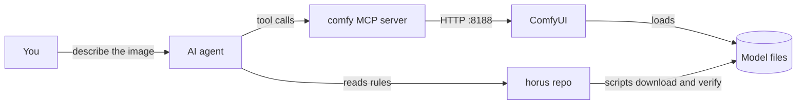

# horus

Get your first image from a local AI model, with an AI agent at the controls.

horus is a starter kit for engineers who are new to local image generation.
It installs [ComfyUI](https://github.com/comfyanonymous/ComfyUI) on a Windows PC
with an NVIDIA GPU, downloads one verified model set (FLUX 3 Image Klein), and
gives an AI agent (Claude Code or Codex) the written rules it needs to drive
ComfyUI for you through the comfy MCP server.

You describe the image. The agent reads this repo, builds or changes a
workflow, checks it against your running ComfyUI, runs it, and shows you the
result.

## The parts

| Part | What it is |
|---|---|
| ComfyUI | The program that runs image models on your GPU. A job is a graph of nodes, called a workflow. |
| comfy MCP server | A local process that gives an agent tools such as `validate_workflow` and `run_workflow`. MCP (Model Context Protocol) is the standard way an agent calls tools. |
| This repo | The rules, scripts, workflows and saved prompts. The agent reads it. You run its scripts. |
| Model files | Gigabytes of weights on disk. Never in git. Each file is checked by SHA-256. |

## Start here

1. **Set up the machine:** [`docs/setup.md`](docs/setup.md). Six steps, from
   an empty PC to a test image. Every script is safe to run again.
2. **Make your first image:** [`workflows/it-illustration`](workflows/it-illustration/README.md).
   Ask the agent for "an illustration of a message queue", or run
   `python scripts/run-illustration.py --subject "..."` without an agent.
3. **Make your own style:** [`docs/style-to-workflow.md`](docs/style-to-workflow.md).
   How the agent goes from one sentence to a tested, saved workflow.

New to the words? Read [`docs/concepts.md`](docs/concepts.md) first.

## What you need

- Windows 10 or 11, NVIDIA GPU with 6 GB VRAM or more, 16 GB RAM, about 20 GB free disk.
- Git, Python 3.12, and a free Hugging Face account.
- An AI agent CLI: [Claude Code](https://claude.com/claude-code) or Codex.

## Docs

| | |
|---|---|
| [`docs/setup.md`](docs/setup.md) | Flow 1: a fresh machine to a working setup |
| [`docs/style-to-workflow.md`](docs/style-to-workflow.md) | Flow 2: a style description to a tested workflow |
| [`docs/concepts.md`](docs/concepts.md) | Every term, what it does, what breaks if it is wrong |
| [`docs/running-workflows.md`](docs/running-workflows.md) | The MCP run loop and its failure modes |
| [`docs/models.md`](docs/models.md) | The verified model catalog |
| [`docs/why-flux3-klein.md`](docs/why-flux3-klein.md) | Why FLUX 3 Image Klein, what else was tried, small-GPU traps |
| [`ROADMAP.md`](ROADMAP.md) | Where horus goes next |

## Workflows

| Workflow | Does | Model family |
|---|---|---|
| [`it-illustration`](workflows/it-illustration/README.md) | Text to flat-vector tech illustration, 1536×1024 | FLUX 3 Image Klein |

## License

The code and docs in this repo are MIT ([`LICENSE`](LICENSE)). The models have
their own licenses. FLUX 3 Image Klein uses the FLUX Kommunity License, which
you accept on Hugging Face before the download works.
