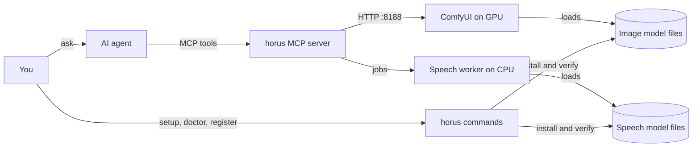
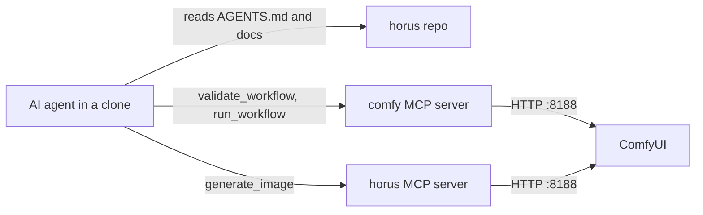

# horus

horus gives an AI agent (Claude Code or Codex) tools to make images and Vietnamese
speech with local AI models on your own machine. The machine is a Windows PC with an
NVIDIA GPU, or a Mac with Apple Silicon. The agent calls the horus MCP server. MCP
(Model Context Protocol) is the standard way an agent calls tools. horus sets up the
models, runs the job and returns the path of the file.

New here? Read Features, then Quick start.

## Features

| Feature | What it does | Detail |
|---|---|---|
| Images (`it-illustration`) | Text to image with FLUX 3 Image Klein. Size 1536×1024, PNG. Runs on your GPU. | [workflow](workflows/it-illustration/README.md) |
| Vietnamese speech (`vi-speech`) | Vietnamese text to speech, 25 preset voices, WAV or MP3. Runs on the CPU. | [workflow](workflows/vi-speech/README.md) |
| Tools for any agent | Six MCP tools. `horus register` gives them to an agent in any folder. | [`docs/mcp.md`](docs/mcp.md) |
| Safe setup and removal | A plan first, then `-yes`. SHA-256 checks. Consent before a package and before a license. `horus uninstall` removes what horus installed. | [`docs/setup.md`](docs/setup.md) |
| Docker stack | A job queue, the Horus UI and MCP over HTTP. Images only. | [stack](docs/setup.md#run-horus-as-a-stack) |
| Your own workflows | An agent in a clone of this repo builds a new workflow with the comfy MCP server. | [`docs/style-to-workflow.md`](docs/style-to-workflow.md) |

## How it works



A workflow is a named recipe: a model set plus its settings, for example
`it-illustration`. ComfyUI is the program that runs image models on your GPU.
The agent talks only to the horus MCP server and never sees ComfyUI or the speech
worker. The horus MCP server and the horus commands are one program, `horus`.

## Quick start

### Install horus

Run one line. It downloads the program from the newest
[GitHub Release](https://github.com/hieplam/horus/releases) and puts it on your PATH.
You need no clone, no Go and no Python for this step.

On Windows 10 or 11 (64-bit), open PowerShell and run:

```
irm https://raw.githubusercontent.com/hieplam/horus/main/install.ps1 | iex
```

On macOS with Apple Silicon, open Terminal and run:

```
curl -fsSL https://raw.githubusercontent.com/hieplam/horus/main/install.sh | sh
```

Open a new terminal, then check the program:

```
horus version
```

The script checks the SHA-256 of the download. SHA-256 is a hash of the file. A
download that does not match is never installed. To install without the script, see
[install by hand](docs/setup.md#install-by-hand).

Settings, set before the line: `HORUS_VERSION` picks a release (default: the newest).
`HORUS_INSTALL_DIR` picks the program folder. `HORUS_INSTALL_NO_PATH=1` leaves the PATH
unchanged.

If it fails:

- `horus` is "not recognized" or "command not found": open a new terminal.
- The SHA-256 is wrong: the script installed nothing. Run the line again.
- The script cannot download: check [the releases page](https://github.com/hieplam/horus/releases).

### Set up a workflow

**Image.** The model files need a Hugging Face token and the FLUX Kommunity License.
Write `HF_TOKEN=<your token>` in `~/horus/.env` (macOS) or `%USERPROFILE%\horus\.env`
(Windows). [Setup step 1](docs/setup.md#step-1-put-your-hugging-face-token-in-env)
shows how to get the token. Then:

```
horus setup it-illustration
horus setup it-illustration -yes
```

The first command prints the plan and changes nothing. The second runs it: ComfyUI,
then 11 GB of model files. Add `-with-packages` to approve 7-Zip (Windows) or
Python 3.12 (macOS).

**Speech.** One command sets up Python 3.12, FFmpeg, the speech venv and 1.1 GB of models:

```
horus setup vi-speech -yes -with-packages
```

Both commands are safe to run again. Check a workflow with `horus doctor -workflow <name>`.

### Connect your agent

```
horus register
```

For Codex, run `horus register -client codex`. Restart the agent. Type `/mcp`. The
server `horus` must show as connected.

### Make your first image and audio file

Start the agent in any folder and ask:

- Image: "Make a flat vector illustration of a message queue."
- Speech: "Read this text aloud in Vietnamese with the voice Hải Đăng: Xin chào, tôi là Hải Đăng. Hôm nay chúng ta sẽ nói về hàng đợi tin nhắn."

For an image, the agent returns the path of a PNG. For speech, it returns the path of
the audio file and its transcript. Compare the transcript with your text. Files go to
`outputs/` in the user folder (`~/horus` or `%USERPROFILE%\horus`). Without an agent, run
`horus run-illustration -subject "..."` for an image. Speech has no command: it needs the agent.

## Use horus from an agent

| Tool | What it does |
|---|---|
| `list_workflows` | Lists the workflows and their kind (image or speech). |
| `describe_workflow` | Gives the rules and the inputs of one workflow. |
| `install_workflow` | Sets up a workflow. It asks consent first. |
| `uninstall_workflow` | Removes the files of a workflow. |
| `generate_image` | Makes a PNG from a workflow and a subject. |
| `generate_speech` | Makes an audio file and its transcript from a workflow, a text and a voice. |

The usual flow: `list_workflows`, `describe_workflow`, `install_workflow`, then
`generate_image` or `generate_speech`. `install_workflow` asks you before a package
step (`accept_setup`) and before the model download (`accept_license`). An error has
`error.code`, `error.next_step` and `error.action_by`, so the agent knows if it must
retry, change its call or ask you. An agent in any folder can use the tools. Details:
[`docs/mcp.md`](docs/mcp.md).

## Workflows

| Workflow | Does | Model family | Kind | Runs on | Size |
|---|---|---|---|---|---|
| [`it-illustration`](workflows/it-illustration/README.md) | Text to image, 1536×1024. No style of its own: the caller writes the look. | FLUX 3 Image Klein | image | GPU (ComfyUI) | 11 GB |
| [`vi-speech`](workflows/vi-speech/README.md) | Vietnamese text to speech, 25 voices, 2 to 4,000 characters. | VieNeu-TTS v3 Turbo | speech | CPU | 1.1 GB |

Manage them with `horus workflow list`, `install <name>`, `check <name>` and
`remove <name>`. See [manage workflows](docs/setup.md#manage-workflows-list-install-check-remove).

## Run horus as a Docker stack

The stack adds a job queue, the Horus UI and MCP over HTTP. It makes images only.
It needs a clone of this repo and Docker (Docker Desktop on Windows or macOS).
ComfyUI stays on the host: start it with `horus start-comfyui`. The stack never starts it.

- `horus-db`: Postgres, the job store.
- `horus-worker`: runs the jobs of the queue on ComfyUI.
- `horus-api`: serves `/mcp`, the Horus UI, `/readyz` and `/livez`.

```
# In the .env of the clone: HORUS_DB_PASSWORD=<long random>, and HORUS_API_TOKEN for HTTP
# Set HORUS_MODELS_DIR (and optional HORUS_SHARED_DIRS)
horus stack-mounts
docker compose up -d --wait
docker exec horus-api horus ready
horus register -docker
```

`horus ready` must print 4 lines that say `ok`. `horus register -docker` connects by
stdio. `horus register -http` connects to `http://127.0.0.1:8190/mcp` with the header
`Authorization: Bearer <HORUS_API_TOKEN>`.

The Horus UI is a read-only page at `http://127.0.0.1:8190/` (the port is `HORUS_API_PORT`).
It shows the readiness, the queue, the running jobs, the recent results, the worker and the
workflows. In the stack, `generate_speech` and the install of a speech workflow answer
`BACKEND_UNAVAILABLE`. Use the horus program on the host for speech.
Full steps: [`docs/setup.md`](docs/setup.md#run-horus-as-a-stack).

## Uninstall

`horus uninstall` prints the plan (`REMOVE` and `KEEP` lines) and changes nothing.
`horus uninstall -yes` removes what horus installed: model files, the ComfyUI folder,
the speech venv, the registration, the built-in workflow copy, the PATH entry and the
program. Nobody can undo it, so read the plan first. It keeps `.env`, `outputs/` and
system packages. `-models` and `-mcp` limit the command. The full table is in
[`docs/setup.md`](docs/setup.md#uninstall).

## What you need

- Windows 10 or 11, NVIDIA GPU with 6 GB VRAM or more, 16 GB RAM, about 20 GB free disk.
- Or macOS on Apple Silicon with 16 GB of memory and about 14 GB free disk.
  Linux and Intel Macs are not supported.
- A free Hugging Face account, to accept the FLUX license (images).
- Python 3.12 on macOS, for comfy-cli. `horus setup` installs it after you approve it.
- For speech: Python 3.12 and FFmpeg on both systems (`-with-packages` installs them),
  1.1 GB of disk and no GPU.
- An AI agent CLI: [Claude Code](https://claude.com/claude-code) or Codex.
- Go 1.27.3 or newer, Git and Python 3.12, only to work on the code of horus.
  The [prerequisites](docs/setup.md#prerequisites) list each item for each system.

## Work on this repo (developers)

This section is for people who change the code of horus. Agents read
[`AGENTS.md`](AGENTS.md). In a clone, the file `.mcp.json` gives the agent two servers:
the comfy MCP server (low-level ComfyUI tools to build and debug a workflow) and the
horus MCP server.



1. Install Go 1.27.3 or newer, Python 3.12 and Claude Code.
2. Clone this repo. Open a terminal in its root folder.
3. Run `go install ./cmd/horus`, then `horus install-comfy-mcp`.
4. Run `horus doctor`. No line may show `FAIL`.
5. Start `claude` in the folder. Approve the servers `comfy-mcp` and `horus`.
6. Type `/mcp`. Both servers must show as connected.

Before a pull request, run `python scripts/lint-public.py`, `gofmt -l .` and
`go test ./...`. More: [setup for developers](docs/setup.md#for-developers-work-in-a-clone)
and [`docs/style-to-workflow.md`](docs/style-to-workflow.md).

## Docs

| | |
|---|---|
| [`docs/setup.md`](docs/setup.md) | Flow 1: a fresh machine to a working setup |
| [`docs/style-to-workflow.md`](docs/style-to-workflow.md) | Flow 2: a style description to a tested workflow |
| [`docs/concepts.md`](docs/concepts.md) | Every term, what it does, what breaks if it is wrong |
| [`docs/running-workflows.md`](docs/running-workflows.md) | For developers: the comfy MCP run loop, to build and debug a workflow, and its failure modes |
| [`docs/mcp.md`](docs/mcp.md) | The horus MCP server: tools, result envelope, error codes, long calls |
| [`docs/models.md`](docs/models.md) | The verified model catalog |
| [`docs/why-flux3-klein.md`](docs/why-flux3-klein.md) | Why FLUX 3 Image Klein, what else was tried, small-GPU traps |
| [`workflows/vi-speech/README.md`](workflows/vi-speech/README.md) | The speech workflow: voices, tags, limits |
| [`docs/adr/README.md`](docs/adr/README.md) | Decision records |
| [`ROADMAP.md`](ROADMAP.md) | Where horus goes next |

## License

The code and docs in this repo are MIT ([`LICENSE`](LICENSE)). FLUX 3 Image Klein uses
the FLUX Kommunity License, which you accept on Hugging Face before the download works.
The vi-speech models use Apache-2.0 (VieNeu-TTS, MOSS Audio Tokenizer Nano) and MIT (Whisper).
