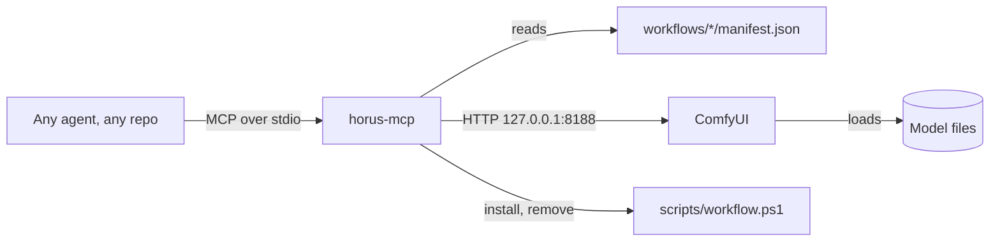

# horus as an MCP server

The horus MCP server lets any AI agent on this PC make an image with a named
workflow. The agent calls five tools. It does not need to know ComfyUI, the
model files, the graph or the GPU.

Terms:

- **MCP (Model Context Protocol):** the standard way for an agent to call the tools of another program.
- **stdio:** the agent harness starts the server as a child process and sends messages through its standard input and output. Nothing listens on the network.
- **Workflow:** one image model and its ComfyUI graph, a folder under `workflows/`. A workflow has no style of its own. The server offers each folder that has a `manifest.json`.
- **Envelope:** the one result shape that every tool returns (below).



## Install and connect

```powershell
.\scripts\install-horus-mcp.ps1 -Register
```

- The script makes the venv `%USERPROFILE%\.venvs\horus-mcp` and installs this repo into it (editable, `mcp==2.3.0`).
- `-Register` runs `claude mcp add --scope user horus -- <venv>\Scripts\horus-mcp.exe`. Then agents in every folder of this PC see the tools. Start a new Claude Code session after it.
- In this repo, `.mcp.json` also names the server, so an agent here finds it without `-Register`.
- Another harness (Codex, an IDE) needs one stdio server entry: command `<venv>\Scripts\horus-mcp.exe`, no arguments.

The server needs ComfyUI and the setup of [`setup.md`](setup.md). When ComfyUI
does not answer, `generate_image` starts it with `scripts/start-comfyui.ps1`.

## The tools

| Tool | Does | Changes the PC |
|---|---|---|
| `list_workflows` | Lists the workflows: name, summary, `good_for`, `not_good_for`, default size, measured time, `install_state`. | No |
| `describe_workflow(workflow)` | One workflow in full: size limits, how to write the subject (rules and examples), license, the state of each model file. | No |
| `install_workflow(workflow, accept_license=false)` | Downloads and verifies the model files. Without `accept_license=true` it returns `LICENSE_CONFIRMATION_REQUIRED` with the license and the size. | Yes: downloads GB |
| `uninstall_workflow(workflow, confirm=false, remove_shared=false)` | Deletes the model files. Without `confirm=true` it returns `CONFIRMATION_REQUIRED` with the plan. A file that another workflow lists is kept unless `remove_shared=true`. | Yes: deletes files |
| `generate_image(workflow, subject, out_path?, seed?, width?, height?, overwrite=false)` | Makes one PNG and waits until it is on disk. Returns the absolute path and the seed. | Writes one PNG |

The subject is the whole prompt. The server sends it to the model exactly as
written and adds nothing. The caller owns the look: style, palette, light,
composition and design system. A workflow never adds a style. The server
refuses a `manifest.json` that has `theme` or `caption`, and
`tests/mcp_contract.py` checks that the caption equals the subject.

`out_path` must be absolute and end with `.png`. Without it, the PNG goes to
`HORUS_OUTPUT_DIR` (default `.scratch/outputs/<workflow>/` in this repo). The
server never replaces a file unless `overwrite=true`.

## The envelope

Every tool returns the same shape, in `structuredContent` and as JSON text in
`content`. A failed call also sets `isError`.

```json
{"ok": true, "result": {"path": "D:\\out\\cover.png", "seed": 7, "seconds": 241.3, "...": "..."}, "error": null}
```

```json
{"ok": false, "result": null, "error": {
  "code": "WORKFLOW_NOT_INSTALLED",
  "message": "the backend does not list model files of this workflow",
  "retryable": false,
  "action_by": "caller",
  "next_step": "Call install_workflow with workflow='it-illustration', then call generate_image again.",
  "details": {"missing": ["flux2-vae.safetensors"]}}}
```

A caller decides from three fields:

- `retryable`: `true` means that the same call can pass when it is sent again.
- `action_by`: `retry` (send the same call again), `caller` (change the arguments), `human` (the user must act first).
- `next_step`: one sentence that names the next action.

## Error codes

The single source is `horus/errors.py`. The contract test fails when this table misses a code.

| Code | Retryable | Action by | Next step |
|---|---|---|---|
| `INVALID_ARGUMENT` | no | caller | Fix the argument named in `details.field`, then call again. `details` gives the limits. |
| `WORKFLOW_NOT_FOUND` | no | caller | Call `list_workflows` and use one of the names in `details.known`. |
| `WORKFLOW_NOT_INSTALLED` | no | caller | Call `install_workflow` for this workflow, then call `generate_image` again. |
| `LICENSE_CONFIRMATION_REQUIRED` | no | human | Show the license and the download size to the user. When the user agrees, call `install_workflow` again with `accept_license=true`. |
| `CONFIRMATION_REQUIRED` | no | human | Show the plan in `details.files` to the user. When the user agrees, call again with `confirm=true`. |
| `OUTPUT_EXISTS` | no | caller | Pass another `out_path`, or pass `overwrite=true`. |
| `BACKEND_UNAVAILABLE` | yes | human | ComfyUI does not answer and horus could not start it. The user runs `scripts/start-comfyui.ps1` and reads [`setup.md`](setup.md). |
| `BACKEND_NOT_INSTALLED` | no | human | The user sets up horus on this PC: [`setup.md`](setup.md). |
| `BACKEND_RESTART_REQUIRED` | yes | human | ComfyUI must restart to see new model files. The user restarts it, then the caller calls again. |
| `NODE_PACK_MISSING` | no | human | ComfyUI lacks a custom node pack that the workflow needs (`details.missing`). The user installs it. |
| `HF_TOKEN_INVALID` | no | human | Hugging Face answered HTTP 401. The user puts a valid Read token in `HF_TOKEN` in `.env`. |
| `LICENSE_NOT_ACCEPTED` | no | human | Hugging Face answered HTTP 403. The user opens `details.license_url` and accepts the license. |
| `DISK_FULL` | no | human | Not enough free disk space. The user frees space. |
| `FILE_CONFLICT` | no | human | A different file with the same name is on disk (`details.path`). horus never overwrites or deletes it. The user moves or deletes it. |
| `FILE_IN_USE` | yes | human | Windows does not let horus delete a model file that ComfyUI has open. The user stops ComfyUI, then the caller calls again. |
| `DOWNLOAD_FAILED` | yes | retry | Call `install_workflow` again. It resumes the partial download. |
| `OUT_OF_MEMORY` | yes | caller | The GPU ran out of memory. Call again. If it fails again, use a smaller width and height. |
| `GENERATION_FAILED` | yes | retry | Call again with the same arguments. If it fails twice, report `details.backend_message` to the user. Some causes are not retryable; then `retryable` is `false` and `next_step` says why. |
| `GENERATION_TIMEOUT` | yes | retry | The job ran longer than `HORUS_GENERATE_TIMEOUT` (default 1800 s). horus removed it from the ComfyUI queue. Call again later. |
| `CANCELLED` | yes | retry | Someone cancelled the job in ComfyUI. Call again if the image is still needed. |
| `INTERNAL` | no | human | A defect in horus or in a workflow. Report `details` to the user. |

## Long calls

`generate_image` is a direct call: it returns when the PNG is on disk. One
image takes 3 to 8 minutes on a 6 GB GPU, and longer when ComfyUI must start
and load 11 GB of model files first. `install_workflow` can take an hour.

What the harness does with a long call (Claude Code docs, read 2026-11-06,
https://code.claude.com/docs/en/mcp.md):

- A call in the main conversation that runs longer than 2 minutes moves to a background task. The agent gets a task id at once, continues with other work, and gets the result as a notification. `CLAUDE_CODE_MCP_AUTO_BACKGROUND_MS` changes the 2 minutes.
- The default tool-call time limit is about 28 hours (`MCP_TOOL_TIMEOUT`).
- A stdio call that sends no result and no progress for 30 minutes is stopped (`CLAUDE_CODE_MCP_TOOL_IDLE_TIMEOUT`). horus sends a progress notification every 10 s while it waits for an image, and every 5 s while it downloads. A progress notification needs a `progressToken` from the caller.
- Measured 2026-11-06: headless Claude Code 2.1.318 (`claude -p`) sent no `progressToken` in `tools/call` (the server logs `progress_token=None`). So it gets no progress, and an install that runs longer than 30 minutes can hit the idle limit. Set `CLAUDE_CODE_MCP_TOOL_IDLE_TIMEOUT=0` for a long install, or run `scripts/workflow.ps1 install <name>` once by hand. An interactive session is not measured.
- In `claude -p` (headless), a backgrounded call loses its result when the run ends. A headless caller must wait for the call.

Because of the automatic background move, a synchronous tool does not block a
Claude Code agent. MCP tasks (a server-side job id with polling) are a later
step; see [`ROADMAP.md`](../ROADMAP.md).

## Add a workflow to the server

The server offers a workflow when its folder has `manifest.json`. Copy
[`workflows/it-illustration/manifest.json`](../workflows/it-illustration/manifest.json)
and change every field. The fields:

| Field | What it is |
|---|---|
| `name` | Must equal the folder name. |
| `title`, `summary`, `good_for`, `not_good_for` | What the caller reads to choose a workflow. Write what the model can and cannot draw. Do not describe a look: the caller owns the look. |
| `output` | `default_width`, `default_height`, `min_side`, `max_side`, `multiple_of`. Set `max_side` to a size that you ran on the target GPU. |
| `subject` | `min_chars`, `max_chars`, `how_to_write`, `rules`, `examples` (subject, image, seed). The caller writes the subject from these. |
| `timing` | Measured seconds per image and the hardware. |
| `graph.file`, `graph.node_count` | The UI-format graph and its node count. A different count after conversion stops the run. |
| `graph.inputs` | For each of `caption`, `seed`, `width`, `height`, `filename_prefix`: the node class and the input name that horus sets. Exactly one node of that class must exist. |

The caller never sees `graph`: `describe_workflow` leaves it out.

## Settings

Each setting is an environment variable or a line in `.env`. The environment wins.

| Setting | Default | What it does |
|---|---|---|
| `HORUS_COMFYUI_URL` | `http://127.0.0.1:8188` | The ComfyUI address. |
| `HORUS_COMFYUI_DIR` | `%USERPROFILE%\ComfyUI_windows_portable` | The ComfyUI portable folder. |
| `HORUS_OUTPUT_DIR` | `.scratch/outputs` in this repo | Where a PNG goes when the call has no `out_path`. |
| `HORUS_AUTOSTART` | `1` | `0`: never start ComfyUI; return `BACKEND_UNAVAILABLE`. |
| `HORUS_GENERATE_TIMEOUT` | `1800` | Seconds before horus cancels a job and returns `GENERATION_TIMEOUT`. |
| `HORUS_WORKFLOWS_DIR` | `workflows` in this repo | Another workflows folder (tests use it). |
| `HORUS_LOG_FILE` | none | Also write the server log to this file. Each call logs its tool name and its `progressToken`. |

The server never reads `HF_TOKEN`. `scripts/download-model.ps1` reads it and
sends it only to `huggingface.co`.

## Test the server

```powershell
& "$env:USERPROFILE\.venvs\horus-mcp\Scripts\python.exe" tests\mcp_contract.py
```

The contract test starts the server over stdio with the official MCP client.
A fake ComfyUI in the test process answers, so it needs no GPU and no network.
It checks the tools, the schemas, the envelope, each main error code, the
caption, cancel on timeout, and install and uninstall on stand-in model files.
It ends with `contract: N of 27 passed` and exits 0 only when all pass.
