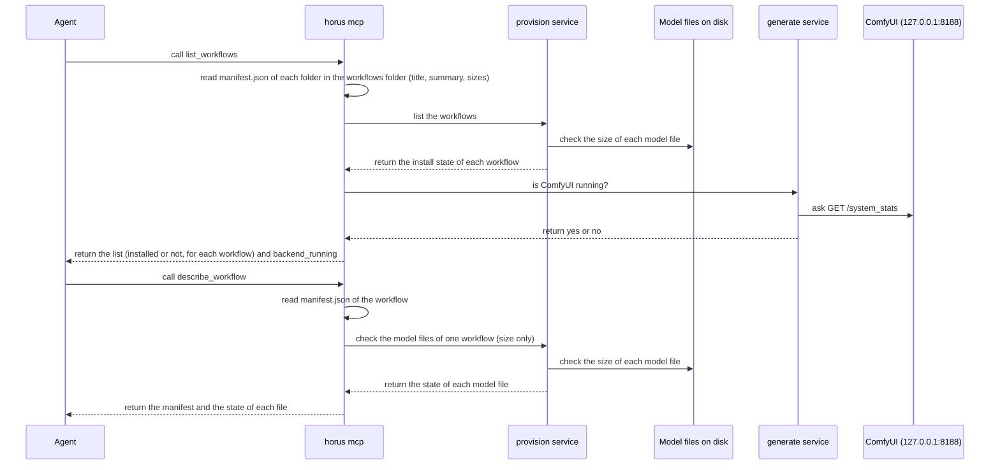
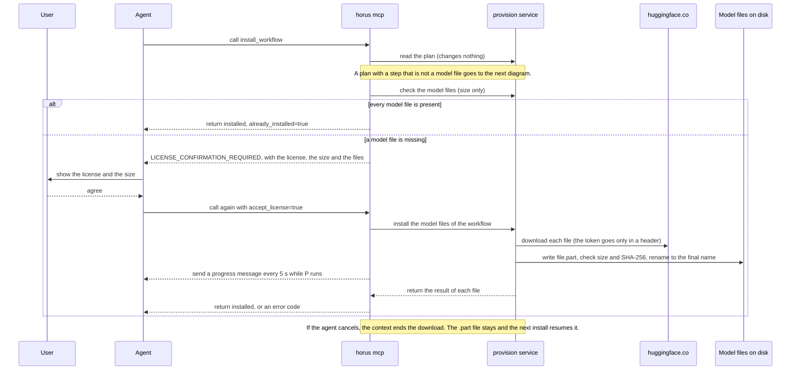
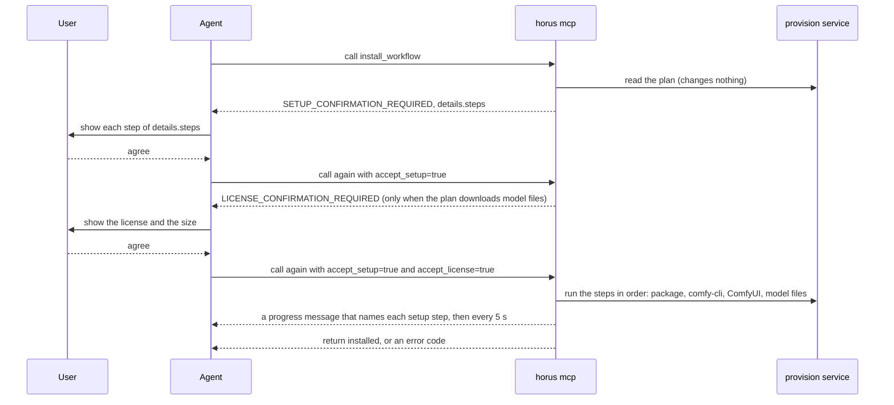
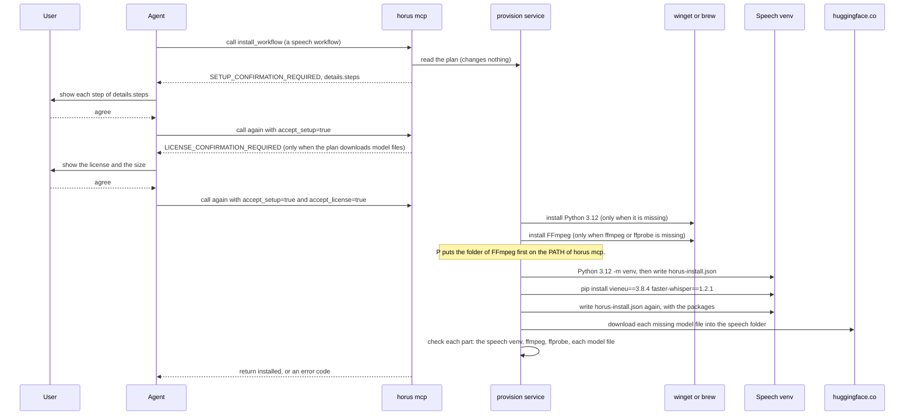
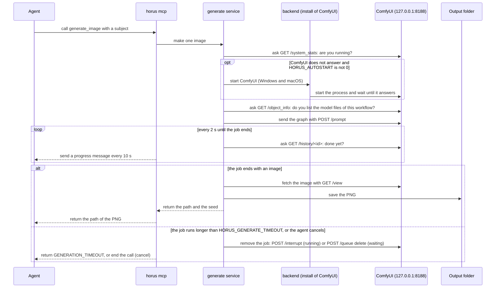
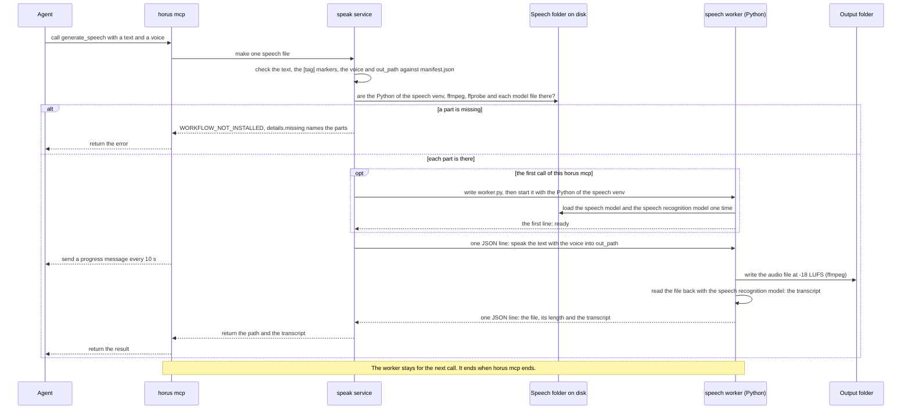
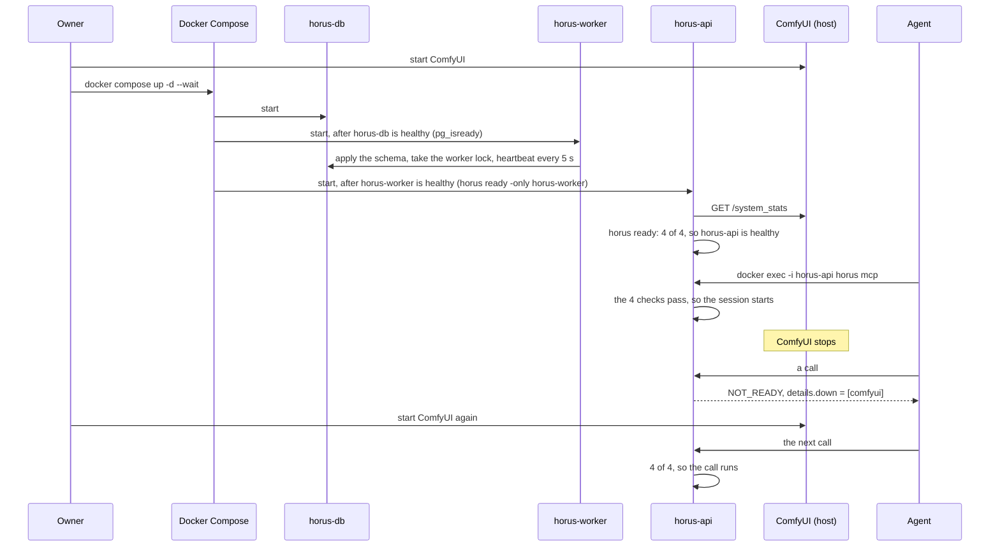
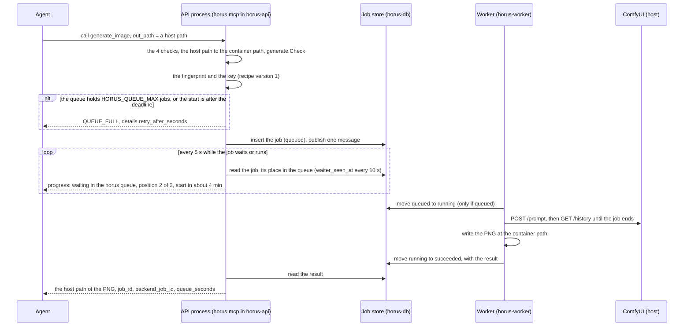

# horus as an MCP server

The horus MCP server lets any AI agent on this PC make an image or speech with
a named workflow. The agent calls six tools. It does not need to know ComfyUI,
the model files, the graph, the GPU, the speech model, Python or ffmpeg.

Terms:

- **MCP (Model Context Protocol):** the standard way for an agent to call the tools of another program.
- **stdio:** the agent harness starts the server as a child process and sends messages through its standard input and output. Nothing listens on the network.
- **Workflow:** one model and what it makes, a folder under `workflows/`. A workflow has a kind: `image` (a model and its ComfyUI graph) or `speech`. A workflow has no style of its own. The server offers each folder that has a `manifest.json`.
- **Envelope:** the one result shape that every tool returns (below).

The server is one process: `horus mcp`. It starts no other horus process.
Inside this one process, the code has three layers. A **handler**
(`internal/mcpserver`) receives the tool call. A **service** does the job. An
**adapter** talks to one outside thing. The handler calls a service. The service
calls an adapter through an interface that the service declares. No call goes
the other way. The spec
[`docs/specs/2026-11-11-restructure.md`](specs/2026-11-11-restructure.md) gives
the full rules, and `go test ./internal/archtest` enforces them.

These parts take part in the diagrams below.

- The **agent** calls the tools.
- **`horus mcp`** is the handler. It answers the agent.
- The **provision service** (`internal/provision`) sets up the model files of a workflow. It lists, checks, installs and removes them.
- The **generate service** (`internal/generate`) makes one image.
- **ComfyUI** is the program that makes the picture.
- The **speak service** (`internal/speak`) makes one speech file.
- The **speech worker** is the Python process that holds the speech model and the speech recognition model in memory ([ADR 0022](adr/0022-speech-runs-in-a-python-speech-worker.md)). `horus mcp` starts it with the Python of the speech venv.

The adapters are `internal/modelfiles` (the model files on the disk),
`internal/download` (the download from huggingface.co), `internal/comfy` (the
ComfyUI client), `internal/backend` (the install of ComfyUI) and
`internal/speechworker` (the speech worker process and its JSON lines).

Each diagram below is one thing that an agent asks for, in order from top to
bottom. A line is an action, named by what it does.

### 1. The agent asks what horus can do (`list_workflows`, `describe_workflow`)



### 2. The agent installs the model files (`install_workflow`)



On a machine without ComfyUI, `install_workflow` first runs the plan of
`horus setup` (the spec
[`2026-11-15-release-install.md`](specs/2026-11-15-release-install.md),
"Setup through MCP"). The plan can have a system package step (7-Zip with
`winget` on Windows, Python 3.12 with `brew` on macOS), a comfy-cli step
(macOS), a ComfyUI step and the model files. The tool asks two consents, in
this order, and changes nothing before both:



- `details.steps` lists each step of the plan: `kind` (`package`, `comfy-cli`, `backend`, `speech-venv` or `file`), `name` (what the step installs), `command` (the program and its arguments of a package step, the pip install of a `speech-venv` step, else `null`) and `dir` (the folder that the step writes to).
- One setup consent covers each step of `details.steps`, also the package steps.
- When the package manager is not found, a person must install the package. The tool then answers `BACKEND_NOT_INSTALLED`, and its `next_step` names the package and where to get it. It changes nothing.
- When a setup step fails, the tool answers `BACKEND_NOT_INSTALLED` with the failed step in `details.step` and the last lines of its output in `details.output_tail`. The next steps do not run.
- On a machine where ComfyUI is installed, the plan of an image workflow has only model files, and the tool asks only the license consent. `accept_setup` changes nothing there.

A speech workflow needs no ComfyUI, so its plan has no ComfyUI step (the spec
[`2026-11-20-text-to-speech.md`](specs/2026-11-20-text-to-speech.md),
"Install and uninstall"). Its steps, in order:

1. A package step for Python 3.12, only when the speech venv must be made and no Python 3.12 is found (`winget` on Windows, `brew` on macOS).
2. A package step for FFmpeg, only when `ffmpeg` or `ffprobe` is not on the PATH.
3. The `speech-venv` step: Python 3.12 makes the speech venv in the speech folder, then pip installs the pinned packages `vieneu==3.8.4` and `faster-whisper==1.2.1`.
4. A `file` step for each missing model file: it goes to `<speech folder>/models/<folder>/<file>`.

The same two consents come first, and the tool changes nothing before both:



- The install record `horus-install.json` of the speech venv has the kind `speech-venv`. horus writes it before the pip install, so `horus uninstall` can remove a venv whose pip install did not end. After the pip install, the record also lists the packages. A venv whose record does not list the pinned packages is not ready: the plan has the `speech-venv` step again. ([ADR 0035](adr/0035-the-install-record-of-the-speech-venv-lists-its-packages.md))
- The tool answers `installed` only when each part of the speech setup is there, the same check that `generate_speech` does before each call.
- A program that a package step installs is not on the PATH of a process that started before the install. horus puts the folder of FFmpeg first on the PATH of its own process, so `generate_speech` of the same `horus mcp` finds it. Another program finds it after a restart: open a new terminal, and restart the agent program.
- A machine where each part is there gets no setup step: the tool answers `already_installed`.

`uninstall_workflow` works the same way: the provision service refuses a file
that another workflow of the same kind lists, then the model files adapter
deletes the files. The files of a speech workflow are in the speech folder. Before
it deletes them, the server ends its speech worker, because Windows does not
delete a file that a process holds open. The next `generate_speech` starts a new
speech worker. `uninstall_workflow` deletes only model files: the speech venv and
`worker.py` stay until `horus uninstall -yes`.

### 3. The agent makes a picture (`generate_image`)



In this diagram the generate service never calls the provision service: a
picture needs the model files to be installed already. If ComfyUI does not list
them, the call returns `WORKFLOW_NOT_INSTALLED`, which tells the agent to run
`install_workflow` first. The backend starts ComfyUI so that it keeps running
after `horus mcp` ends. `horus stop-comfyui` stops it.

### 4. The agent makes speech (`generate_speech`)



The speak service never calls the provision service. A speech file needs the
speech setup to be there already. If a part is missing, the call returns
`WORKFLOW_NOT_INSTALLED`, and its `next_step` tells the agent to run
`install_workflow` first. One worker makes one file at a time, so a second call
waits. If the worker stops or answers with an error, the call returns
`GENERATION_FAILED`, and the next call starts a new worker. A call that runs
longer than `HORUS_GENERATE_TIMEOUT` returns `GENERATION_TIMEOUT`, and horus
stops the worker.

## Install and connect

Install the program with the install line of the [README](../README.md#install-horus) or of [step 0 of `setup.md`](setup.md#step-0-install-the-horus-program). Then run:

```
horus register
```

- `horus register -client codex` registers the server with Codex instead of Claude Code.
- A developer of this repo builds the program with `go install ./cmd/horus`. The Go bin folder must be on the PATH: see [`setup.md`](setup.md#build-horus). After a `git pull`, run `go install ./cmd/horus` again.
- In this repo, `.mcp.json` names the server as the command `horus` with the argument `mcp`, so an agent here finds it without `horus register`.
- The same `.mcp.json` starts the comfy MCP server as `horus comfy-mcp`, on Windows and on macOS. `horus comfy-mcp` runs the program `comfy-mcp` of the venv of `horus install-comfy-mcp` (`<home>/.venvs/comfy-mcp`), else the `comfy-mcp` of the PATH, over the same standard input and output. It sets `PYTHONUTF8=1` and `PYTHONIOENCODING=utf-8`, and `COMFY_BIN` to the `comfy` next to comfy-mcp when that program exists and `COMFY_BIN` is not set. Its exit code is the exit code of comfy-mcp. When it finds no comfy-mcp, it writes `comfy-mcp was not found in ... Fix: horus install-comfy-mcp` to the standard error and exits 1.
- `horus register` adds the server `horus` to Claude Code. It runs `claude mcp add --scope user horus -- <path of horus> mcp`. In a clone it also passes `-e HORUS_ROOT=<clone>`. Then agents in every folder of this PC see the tools. Start a new Claude Code session after it.
- `horus register -client codex` adds the server to Codex. It runs `codex mcp get horus`. When that exits 0, it prints a `SKIP` line. Else it runs `codex mcp add horus -- <path of horus> mcp`, with `--env HORUS_ROOT=<clone>` in a clone. `-client claude` is the default. Another client name exits 2 and lists `claude, codex`.
- `horus register -docker` adds horus in the stack: `claude mcp add --scope user horus -- <path of docker> exec -i horus-api horus mcp`, with no `HORUS_ROOT`. `-stack <name>` names another stack (the container `<name>-api`). `-client codex` works the same way. Remove an older entry first (`claude mcp remove horus`), because register skips a client that already knows a server named horus. See [the stack and its readiness](#the-stack-and-its-readiness).
- `<repo root>` is the absolute path of the horus clone that holds the current folder, or the folder of `-root <repo folder>` (it must have `workflows/`). With no clone and no `-root`, the program has no repo root: `horus register` still works and passes no `HORUS_ROOT`. Use `-horus-path <path>` to register another `horus` program.
- Another harness (an IDE) needs one stdio server entry: command `horus` (or its full path), argument `mcp`, and `HORUS_ROOT` when it starts outside this repo.

The server finds the repo through `HORUS_ROOT`, then the nearest folder at or
above the current folder that is a horus clone (a folder with
`workflows/_template/README.md`). Without a clone, the program uses its
built-in workflows: the build puts the workflow folders into the program, and
the program copies them to `<user folder>/builtin-workflows`. The user folder
is `HORUS_HOME`, default `<home>/horus`. It holds `.env` and `outputs/` when
there is no repo. It needs ComfyUI and the setup of [`setup.md`](setup.md). When ComfyUI
does not answer, `generate_image` starts it in the same way as `horus start-comfyui`
(the backend of `internal/backend`, in the process of the server).
`horus stop-comfyui` stops a ComfyUI that horus started, and no other one. The
backend writes the file `horus-comfyui.state.json` in the install folder when
it starts ComfyUI, and `horus stop-comfyui` reads it.

## The tools

| Tool | Does | Changes the PC |
|---|---|---|
| `list_workflows` | Lists the workflows: name, `kind` (`image` or `speech`), summary, `good_for`, `not_good_for`, default size, measured time, `install_state`. | No |
| `describe_workflow(workflow)` | One workflow in full, with its `kind`. An image workflow shows size limits and how to write the subject (rules and examples). A speech workflow shows `text` (limits), `voices`, `default_voice`, `tags` and `formats`, and no graph. Both show the license and the state of each model file. | No |
| `install_workflow(workflow, accept_license=false, accept_setup=false)` | Downloads and verifies the model files. Without `accept_license=true` it returns `LICENSE_CONFIRMATION_REQUIRED` with the license and the size. When the machine needs a setup step (ComfyUI for an image workflow; Python 3.12, FFmpeg or the speech venv for a speech workflow), it first runs the setup plan: without `accept_setup=true` it returns `SETUP_CONFIRMATION_REQUIRED` with the steps. | Yes: downloads GB, installs ComfyUI, a venv and a system package |
| `uninstall_workflow(workflow, confirm=false, remove_shared=false)` | Deletes the model files of an image workflow or a speech workflow. Without `confirm=true` it returns `CONFIRMATION_REQUIRED` with the plan. A file that another workflow of the same kind lists is kept unless `remove_shared=true`. | Yes: deletes files |
| `generate_image(workflow, subject, out_path?, seed?, width?, height?, overwrite=false, idempotency_key?)` | Makes one PNG and waits until it is on disk. Returns the absolute path, the seed, `job_id`, `backend_job_id` and `queue_seconds`. | Writes one PNG |
| `generate_speech(workflow, text, voice?, out_path?, overwrite=false)` | Makes one audio file and waits until it is on disk. Returns the absolute path and the transcript. | Writes one audio file |

The install state (`install_state`: `installed`, `partially_installed` or `not_installed`) counts the parts that the workflow needs. An image workflow has its model files in the model folders of ComfyUI. A speech workflow has its parts in the speech folder (ADR 0032): the speech venv, each model file of `models.json` at `<speech folder>/models/<folder>/<file>` with its size, and the programs `ffmpeg` and `ffprobe` on the PATH. `install_state` is `installed` only when `generate_speech` finds each part. `describe_workflow` shows each model file as `present`, `missing` or `wrong_size`.

`generate_image` accepts a workflow of the kind `image` only. With a workflow of the kind `speech` it answers `INVALID_ARGUMENT`, and `next_step` names `generate_speech`. `generate_speech` accepts a workflow of the kind `speech` only. With a workflow of the kind `image` it answers `INVALID_ARGUMENT`, and `next_step` names `generate_image`.

The subject is the whole prompt. The server sends it to the model exactly as
written and adds nothing. The caller owns the look: style, palette, light,
composition and design system. A workflow never adds a style. The server
refuses a `manifest.json` that has `theme` or `caption`, and
`tests/mcp_contract.py` checks that the caption equals the subject.

`out_path` must be absolute and end with `.png`. Without it, the PNG goes to
`HORUS_OUTPUT_DIR` (default `.scratch/outputs/<workflow>/` in this repo, or
`<user folder>/outputs/<workflow>/` without a repo). The
server never replaces a file unless `overwrite=true`. In the stack, `out_path`
must be in a shared folder: see [`generate_image` in the stack](#generate_image-in-the-stack).

The result of `generate_image` has `workflow`, `path`, `bytes`, `width`,
`height`, `seed`, `seconds`, `backend_seconds`, `started_backend`, `job_id`,
`backend_job_id` and `queue_seconds`. `backend_job_id` is the id of the job in
ComfyUI. On this machine without the stack, `job_id` is that id too, and
`queue_seconds` is `null`. In the stack, `job_id` is the horus job id, and
`queue_seconds` is the wait in the horus queue. `idempotency_key` is an
optional key of the request: in the stack, horus keeps it with the job. Each
call makes a new image, also with the same key.

### `generate_speech`

The caller gives only a text and a voice. No argument names the speech model,
Python, ffmpeg or the loudness ([ADR 0023](adr/0023-a-workflow-has-a-kind-and-each-kind-has-its-tool.md)).

| Argument | What it is |
|---|---|
| `workflow` | A workflow of the kind `speech` from `list_workflows`. |
| `text` | The text to speak. horus sends it to the speech worker as written: it adds no words and removes no words. Its length must be in `text.min_chars` to `text.max_chars` of `describe_workflow`. A `[tag]` in the text must be one of `tags` of `describe_workflow`, because the speech model reads any other `[tag]` aloud. |
| `voice` | A name from `voices` of `describe_workflow`. Default: `default_voice`. |
| `out_path` | An absolute path that ends with `.wav` or `.mp3`. The end gives the format. Default: a new `.wav` file in `HORUS_OUTPUT_DIR/<workflow>/`. |
| `overwrite` | Replace `out_path` when it exists. Default: `false`. |

The result has `workflow`, `voice`, `path`, `bytes`, `format`, `audio_seconds`,
`transcript`, `seconds` and `started_worker`. `.wav` is 48 kHz, 16-bit, mono.
`.mp3` is 44.1 kHz, 128 kbps, mono. The loudness of each file is -18 LUFS
(Loudness Units relative to Full Scale), and the caller cannot change it.

The `transcript` is the words that the speech recognition model reads from the
audio file. An agent cannot listen to the file, so it compares the transcript
with its text and decides. horus does not compare them
([ADR 0024](adr/0024-generate-speech-returns-a-transcript.md)).
A transcript can differ from the text in a few words while the audio can be
right: the speech recognition model can write a word with another tone or
another letter that sounds almost the same. `text.rules` of
`describe_workflow` gives the share of wrong words that the workflow measured
for a right file and for a wrong file.
`started_worker` is `true` when the call had to start the speech worker first:
the first call of a `horus mcp` process also loads the models (5 to 20 s).

Before the speech worker runs, the speak service checks the speech setup in the
speech folder (`HORUS_SPEECH_DIR`, default `<user folder>/speech`,
[ADR 0032](adr/0032-the-speech-setup-is-one-folder-in-the-user-folder.md)):

- `venv/`: the speech venv. Its Python runs the speech worker.
- `models/`: the model files of `models.json`, each in its `folder`, with its byte size.
- `worker.py`: the file of the speech worker. horus writes it before each start.
- The programs `ffmpeg` and `ffprobe` on the PATH.

A part that is not there gives `WORKFLOW_NOT_INSTALLED`, and `details.missing`
names each missing part.

## The envelope

Every tool returns the same shape, in `structuredContent` and as JSON text in
`content`. A failed call also sets `isError`.

```json
{"ok": true, "result": {"path": "D:\\out\\cover.png", "seed": 7, "seconds": 241.3, "...": "..."}, "error": null}
```

```json
{"ok": false, "result": null, "error": {
  "code": "WORKFLOW_NOT_INSTALLED",
  "message": "the backend does not list model files of this workflow",
  "retryable": false,
  "action_by": "caller",
  "next_step": "Call install_workflow with workflow='it-illustration', then call generate_image again.",
  "details": {"missing": ["flux2-vae.safetensors"]}}}
```

A caller decides from three fields:

- `retryable`: `true` means that the same call can pass when it is sent again.
- `action_by`: `retry` (send the same call again), `caller` (change the arguments), `human` (the user must act first).
- `next_step`: one sentence that names the next action.

## Error codes

The single source is the Go package `internal/herr`. It has 25 codes. `horus errors` prints the table, and `horus errors -json` prints it as JSON. The contract test reads `horus errors -json` and fails when this table misses a code.

| Code | Retryable | Action by | Next step |
|---|---|---|---|
| `INVALID_ARGUMENT` | no | caller | Fix the argument named in `details.field`, then call again. `details` gives the limits. |
| `WORKFLOW_NOT_FOUND` | no | caller | Call `list_workflows` and use one of the names in `details.known`. |
| `WORKFLOW_NOT_INSTALLED` | no | caller | Call `install_workflow` for this workflow, then call `generate_image` (or `generate_speech`) again. For speech, `details.missing` names the missing parts: `speech venv`, `ffmpeg`, `ffprobe` or a model file. |
| `LICENSE_CONFIRMATION_REQUIRED` | no | human | Show the license and the download size to the user. When the user agrees, call `install_workflow` again with `accept_license=true`. |
| `SETUP_CONFIRMATION_REQUIRED` | no | human | Show each step in `details.steps` to the user. When the user agrees, call `install_workflow` again with `accept_setup=true`. |
| `CONFIRMATION_REQUIRED` | no | human | Show the plan in `details.files` to the user. When the user agrees, call again with `confirm=true`. |
| `OUTPUT_EXISTS` | no | caller | Pass another `out_path`, or pass `overwrite=true`. |
| `BACKEND_UNAVAILABLE` | yes | human | ComfyUI does not answer and horus could not start it. The user runs `horus start-comfyui` and reads [`setup.md`](setup.md). |
| `BACKEND_NOT_INSTALLED` | no | human | The user sets up horus on this PC: [`setup.md`](setup.md). |
| `BACKEND_RESTART_REQUIRED` | yes | human | ComfyUI must restart to see new model files. The user restarts it, then the caller calls again. |
| `NODE_PACK_MISSING` | no | human | ComfyUI lacks a custom node pack that the workflow needs (`details.missing`). The user installs it. |
| `HF_TOKEN_INVALID` | no | human | Hugging Face answered HTTP 401. The user puts a valid Read token in `HF_TOKEN` in `.env`. |
| `LICENSE_NOT_ACCEPTED` | no | human | Hugging Face answered HTTP 403. The user opens `details.license_url` and accepts the license. |
| `DISK_FULL` | no | human | Not enough free disk space. The user frees space. |
| `FILE_CONFLICT` | no | human | A different file with the same name is on disk (`details.path`). horus never overwrites or deletes it. The user moves or deletes it. |
| `FILE_IN_USE` | yes | human | Windows does not let horus delete a model file that ComfyUI has open. The user stops ComfyUI, then the caller calls again. |
| `DOWNLOAD_FAILED` | yes | retry | Call `install_workflow` again. It resumes the partial download. |
| `OUT_OF_MEMORY` | yes | caller | The GPU ran out of memory. Call again. If it fails again, use a smaller width and height. |
| `GENERATION_FAILED` | yes | retry | Call again with the same arguments. If it fails twice, report `details.backend_message` to the user. Some causes are not retryable; then `retryable` is `false` and `next_step` says why. For speech, the speech worker stopped or answered with an error: report `details.worker_message`. The next call starts a new speech worker. |
| `GENERATION_TIMEOUT` | yes | retry | The job ran longer than `HORUS_GENERATE_TIMEOUT` (default 1800 s). horus removed it from the ComfyUI queue, or stopped the speech worker. Call again later. In the stack, `details.phase` is `running` (the run took too long) or `queued` (the job waited longer than `HORUS_QUEUE_TIMEOUT` and never started). |
| `CANCELLED` | yes | retry | Someone cancelled the job in ComfyUI. Call again if the image is still needed. |
| `NOT_READY` | yes | human | horus runs in the stack, and a dependency of horus is down: `details.down` names it, and `details.checks` gives each of the 4 checks. Tell the user. The user starts it, then the caller calls again. See [the stack and its readiness](#the-stack-and-its-readiness). |
| `QUEUE_FULL` | yes | retry | In the stack: the horus queue holds `HORUS_QUEUE_MAX` jobs, or the estimated start of the job is after its deadline. Call again after `details.retry_after_seconds`. `details.reason` is `count` or `deadline`. |
| `WORKER_LOST` | yes | retry | In the stack: the worker stopped while it ran the job. Call again. |
| `INTERNAL` | no | human | A defect in horus or in a workflow. Report `details` to the user. |

## Long calls

`generate_image` is a direct call: it returns when the PNG is on disk. One
image takes 3 to 8 minutes on a 6 GB GPU, and longer when ComfyUI must start
and load 11 GB of model files first. `generate_speech` is a direct call too: a
sentence takes 5 to 9 s on the CPU, a text of 4,000 characters about 4.5
minutes. `install_workflow` can take an hour.

What the harness does with a long call (Claude Code docs, read 2026-11-06,
https://code.claude.com/docs/en/mcp.md):

- A call in the main conversation that runs longer than 2 minutes moves to a background task. The agent gets a task id at once, continues with other work, and gets the result as a notification. `CLAUDE_CODE_MCP_AUTO_BACKGROUND_MS` changes the 2 minutes.
- The default tool-call time limit is about 28 hours (`MCP_TOOL_TIMEOUT`).
- A stdio call that sends no result and no progress for 30 minutes is stopped (`CLAUDE_CODE_MCP_TOOL_IDLE_TIMEOUT`). horus sends a progress notification every 10 s while it waits for an image or for a speech file, and every 5 s while it downloads. A progress notification needs a `progressToken` from the caller.
- Measured 2026-11-10: headless Claude Code 2.1.322 (`claude -p --mcp-config <file> --strict-mcp-config`) sends a `progressToken` in `tools/call`. The server log shows `call generate_image progress_token=2`, then one `progress` line every 10 s for 211 s. An older measurement (2026-11-06, Claude Code 2.1.318) showed `progress_token=None`, so update an older Claude Code. An interactive session is not measured.
- Not verified: that a progress notification resets the 30-minute idle timer of 2.1.322. The docs say only that a call stops after 30 minutes with "no response and no progress notification". No `install_workflow` run of more than 30 minutes is measured. So for a long install, keep `CLAUDE_CODE_MCP_TOOL_IDLE_TIMEOUT=0`, or run `horus workflow install <name>` once by hand.
- In `claude -p` (headless), a backgrounded call loses its result when the run ends. A headless caller must wait for the call.

Because of the automatic background move, a synchronous tool does not block a
Claude Code agent. MCP tasks (a server-side job id with polling) are a later
step; see [`ROADMAP.md`](../ROADMAP.md).

## Add a workflow to the server

The server offers a workflow when its folder has `manifest.json`. Copy
[`workflows/it-illustration/manifest.json`](../workflows/it-illustration/manifest.json)
and change every field. The fields:

| Field | What it is |
|---|---|
| `name` | Must equal the folder name. |
| `kind` | `image` or `speech`. Without it the kind is `image`. Any other value is refused. |
| `title`, `summary`, `good_for`, `not_good_for` | What the caller reads to choose a workflow. Write what the model can and cannot draw. Do not describe a look: the caller owns the look. |
| `output` | `default_width`, `default_height`, `min_side`, `max_side`, `multiple_of`. Set `max_side` to a size that you ran on the target GPU. |
| `subject` | `min_chars`, `max_chars`, `how_to_write`, `rules`, `examples` (subject, image, seed). The caller writes the subject from these. |
| `timing` | Measured seconds per image and the hardware. |
| `graph.file`, `graph.node_count` | The UI-format graph and its node count. A different count after conversion stops the run. |
| `graph.inputs` | For each of `caption`, `seed`, `width`, `height`, `filename_prefix`: the node class and the input name that horus sets. Exactly one node of that class must exist. |

The caller never sees `graph`: `describe_workflow` leaves it out.

A manifest of the kind `speech` has no `graph`, no `subject` and no `output`: the server refuses a speech manifest that has one. It has these fields instead:

| Field | What it is |
|---|---|
| `name`, `title`, `summary` | As for an image manifest. `good_for`, `not_good_for` and `timing` are optional. |
| `text` | The limits of the text: `min_chars`, `max_chars`, and how to write it. |
| `voices`, `default_voice` | The voice names, not empty. `default_voice` is one of them. |
| `tags` | The `[tag]` markers that the model performs. |
| `formats` | The audio formats of the result. |

Also add the folder name to the `go:embed` line of
[`workflows/embed.go`](../workflows/embed.go). The release program holds only
the folders on that line. `go test ./workflows` fails when a folder with a
`manifest.json` is not on it.

## Settings

Each setting is an environment variable or a line in `.env`. The environment wins.
`.env` is `<repo root>/.env`, or `<user folder>/.env` when there is no repo root.

| Setting | Default | What it does |
|---|---|---|
| `HORUS_ROOT` | the nearest folder at or above the current folder with `workflows/_template/README.md`; none outside a clone | The repo root, where horus reads `workflows/` and `.env`. Set it when the server must use a repo but starts outside it. Only the environment sets it, not `.env`. |
| `HORUS_HOME` | `<home>/horus` | The user folder: `.env` and `outputs/` without a repo root, and the copy of the built-in workflows. Only the environment sets it, not `.env`. |
| `HORUS_COMFYUI_URL` | `http://127.0.0.1:8188` | The ComfyUI address. `horus doctor`, `horus start-comfyui` and `horus stop-comfyui` also use it when they get no `-server-url`. |
| `HORUS_COMFYUI_DIR` | Windows: `%USERPROFILE%\ComfyUI_windows_portable`. macOS: `~/horus`. | The install folder of ComfyUI. ComfyUI itself is in its subfolder `ComfyUI`. |
| `HORUS_OUTPUT_DIR` | `.scratch/outputs` in this repo, else `<user folder>/outputs` | Where a PNG or an audio file goes when the call has no `out_path`. |
| `HORUS_AUTOSTART` | `1` | `0`: never start ComfyUI; return `BACKEND_UNAVAILABLE`. |
| `HORUS_GENERATE_TIMEOUT` | `1800` | Seconds before horus cancels a job, or stops the speech worker, and returns `GENERATION_TIMEOUT`. In the stack, they count from the start of the run of the job. |
| `HORUS_SPEECH_DIR` | `<user folder>/speech` | The speech folder: the speech venv (`venv/`), the model files of the speech workflows (`models/`) and the file of the speech worker (`worker.py`). |
| `HORUS_WORKFLOWS_DIR` | `workflows` in this repo, else the copy of the built-in workflows | Another workflows folder (tests use it). It replaces the built-in workflows. `horus workflow`, `horus setup` and `horus doctor -workflow` also use it. |
| `HORUS_LOG_FILE` | none | Also write the server log to this file. Each call logs its tool name and its `progressToken`. |
| `HORUS_DATABASE_URL` | none | The Postgres database of the job queue: the job store and the broker. [`horus worker`](#the-worker) and `horus api` need it. With it, `horus mcp` runs as in the stack: it serves only when horus is ready. The password can come from `PGPASSWORD`, so the URL needs none. horus never writes the password to a log. |
| `HORUS_WORKER_CONCURRENCY` | `1` | The slots of `horus worker`: the count of jobs that it runs at the same time. |
| `HORUS_JOB_RETENTION_DAYS` | `30` | `horus worker` deletes a job and its events this many days after the job ended. |
| `HORUS_API_PORT` | `8190` | The port of `horus api` on 127.0.0.1: the [Horus UI](#the-horus-ui), `/readyz` and `/livez`. In the stack, `horus api` listens on this port in the container, and `compose.yaml` publishes the same port only on 127.0.0.1 of the host. The Horus UI answers only to a `Host` header with this port. |
| `HORUS_STACK` | `horus` | The name of the stack in `compose.yaml`: its containers are `<name>-api`, `<name>-worker` and `<name>-db`, its volume `<name>-db-data`, its image `<name>:local`. `horus register -docker` uses it for the name of the container. |
| `HORUS_DB_PASSWORD` | none | Only for `docker compose`: the password of the database in `horus-db`. `compose.yaml` gives it to the containers as `PGPASSWORD`. |
| `HORUS_QUEUE_MAX` | `20` | In the stack: the count of queued jobs at which a new call gets `QUEUE_FULL`. |
| `HORUS_QUEUE_TIMEOUT` | `7200` | In the stack: the most seconds that a job waits in the queue. The deadline of a job is its insert time plus this time. A job after its deadline never starts. |
| `HORUS_RUN_ESTIMATE` | `240` | In the stack: the seconds of one run that the estimated start of a queued job uses until a job succeeded. Then the mean run time of the last 10 succeeded jobs counts. |
| `HORUS_SHARED_DIRS` | the output folder of horus and `/shared/outputs` | The shared folders of the stack: pairs `<host folder>=<container folder>`, with `;` between two pairs, for example `C:\Users\me\Pictures\horus=/shared/pictures`. Each container folder is one folder under `/shared/`. `horus stack-mounts` reads it on the host. |
| `HORUS_HOST_OS` | set by `horus stack-mounts` | In the stack: the system of the host (`windows`, `darwin` or `linux`). It gives the rules of a host path. |

Only the code of `internal/download` reads `HF_TOKEN`, and `go test ./internal/archtest`
enforces that. It reads the environment variable first, then the line in the `.env` file of the
repo root. It sends the token only to `huggingface.co` hosts. The server runs the download in its own
process, so the token is in the memory of `horus mcp` while an install runs. The server starts no program that gets the token.

## The worker

`horus worker` runs the jobs of the job queue (the spec
[`2026-11-19-job-queue.md`](specs/2026-11-19-job-queue.md)). It is the main
process of the container `horus-worker`. An API process checks the arguments
of a call at once (`generate.Check`), writes the job to the job store and
publishes one message. The worker takes the message and runs the job later
(`generate.Run`).

Terms:

- **Job store:** the tables of the jobs in Postgres: `horus.jobs`, `horus.job_events` and `horus.workers`.
- **Broker:** the part that moves the messages to the worker. The Postgres broker uses the table `horus.messages`.
- **Delivery:** the broker gives one message to the worker. The worker sends an ack when the job ends, and the broker deletes the message.
- **Slot:** a place in the worker for one running job.

| Part | What the worker does |
|---|---|
| Slots | It runs `HORUS_WORKER_CONCURRENCY` jobs at the same time. This count is also the prefetch: the broker gives at most that many deliveries without an ack. |
| Gate | No delivery starts while ComfyUI does not answer at `HORUS_COMFYUI_URL`, or while the worker does not hold the worker lock. The queued jobs keep their place. The worker asks ComfyUI again every 2 s. It never starts ComfyUI. |
| Idempotent consumer | A delivery runs only when the job store moves its job from `queued` to `running`. Else the worker sends the ack and does nothing. A second delivery of a job that runs on a worker that is gone ends the job with the error `WORKER_LOST`. |
| Run | The worker saves `backend_job_id` (the id of the job in ComfyUI) before it waits. It writes the PNG as `<file>.part`, then renames it. `HORUS_GENERATE_TIMEOUT` counts from the start of the run. |
| Heartbeat | Every 5 s, the worker checks its worker lock. Then the row of the worker in `horus.workers` gets a new `heartbeat_at`. A worker without the lock writes no heartbeat. |
| Worker lock | Only one worker runs. A second `horus worker` prints the first one and exits with 1. The lock is a session lock in Postgres, so a restart of `horus-db` releases it. The worker finds this at its next heartbeat. Then it starts no new delivery, and it takes the lock again on a new session every 2 s. When another worker took the lock first, the worker stops its jobs and exits with 1. |
| Sweep | Every 30 s, and at each delivery: a queued job after its deadline becomes `expired`, and a queued job with no waiter for 60 s becomes `abandoned`. |
| Retention | At its start and one time each day, the worker deletes the jobs that ended more than `HORUS_JOB_RETENTION_DAYS` days ago, with their events. |

At its start, the worker applies the schema `horus` to the database, under an
advisory lock. Each start gets a new worker id. The worker writes one log line
for each start, each delivery, each change of the gate and each failed step to
its standard output. Ctrl+C, or the signal SIGTERM of `docker stop`, stops it.
A job that runs at the stop gets no ack, and the worker removes the job from
ComfyUI. The broker then gives the message again, and the next worker ends the
job with `WORKER_LOST`.

## The stack and its readiness

horus can run as a Docker stack next to the ComfyUI of the host (the spec
[`2026-11-19-job-queue.md`](specs/2026-11-19-job-queue.md),
[ADR 0029](adr/0029-horus-runs-as-a-stack-of-three-containers.md)).
[`setup.md`](setup.md#run-horus-as-a-stack) tells how to start it.

Terms:

- **Stack:** the 3 containers of `compose.yaml`: `horus-db` (Postgres 18.6), `horus-worker` (`horus worker`) and `horus-api` (`horus api`). The names start with `HORUS_STACK` (default `horus`).
- **Dependency:** one of the 4 parts that horus needs: the 3 containers and ComfyUI.
- **Ready:** the checks of the 4 dependencies pass.

| Dependency | Check (2 s at most) | Health check of the container | Starts after |
|---|---|---|---|
| `horus-db` | The database answers, and its schema `horus` has the version of the program | `pg_isready` | nothing |
| `comfyui` | `GET <HORUS_COMFYUI_URL>/system_stats` answers 200 | none: the owner starts ComfyUI on the host | the owner starts it |
| `horus-worker` | The newest row in `horus.workers` has a heartbeat newer than 15 s, and a worker holds the worker lock | `horus ready -only horus-worker` | `horus-db` is healthy |
| `horus-api` | `horus api` answers `GET http://127.0.0.1:<HORUS_API_PORT>/livez` with 200 | `horus ready`: all 4 checks | `horus-db` and `horus-worker` are healthy |

Docker runs each health check every 5 s, and every 1 s in the first 60 s
after a start. Each container has `restart: unless-stopped`.

- `horus ready` runs the 4 checks and prints one `ok` or `FAIL` line for each. Its exit code is 0 only when all pass. It needs `HORUS_DATABASE_URL`, so run it in the stack: `docker exec horus-api horus ready`. `-only <dependency>` runs one check.
- `horus api` is the main process of `horus-api`. It serves `GET /readyz`: the report as JSON, with 200 when horus is ready, else 503. It serves `GET /livez`: 200 while it runs. It serves [the Horus UI](#the-horus-ui) at `/`. It writes the report to its log when the readiness changes (`docker logs horus-api`).
- `horus mcp` with `HORUS_DATABASE_URL` runs the 4 checks at its start. In the stack, the agent starts it with `docker exec -i horus-api horus mcp`. When a check fails, `horus mcp` writes the report to the standard error and exits 1, so the session does not start.
- In an open session, each call runs the 4 checks first. A call while a dependency is down gets `NOT_READY`, with the names of the dependencies that are down in `details.down`. When the dependency is up again, the next call runs. horus needs no action.
- On the host without `HORUS_DATABASE_URL`, `horus mcp` makes no readiness check (the direct path).
- `generate_image` goes through the job queue: see [`generate_image` in the stack](#generate_image-in-the-stack).



What an agent sees:

| State | Over stdio (`docker exec -i horus-api horus mcp`) |
|---|---|
| Docker is down, or `horus-api` is stopped | `docker exec` fails with `container <id> is not running`. The harness shows horus as failed. |
| A new session while a dependency is down | `horus mcp` writes `horus ready: 3 of 4` and a `FAIL <dependency>: <cause>` line, and exits 1. |
| A call in an open session while a dependency is down | `NOT_READY`, `action_by` human, with `details.down`. |
| The dependency is up again | The next session and the next call work. |

### `generate_image` in the stack

With `HORUS_DATABASE_URL`, the API process never calls ComfyUI for a job
([ADR 0025](adr/0025-run-each-job-through-a-broker-and-one-worker.md)). It puts
the job in the job queue, and the worker runs it.

Terms:

- **Host path:** a path of the machine of the agent, for example `C:\Users\me\Pictures\horus\cover.png`.
- **Container path:** the same file as the containers see it, for example `/shared/pictures/cover.png`.
- **Shared folder:** a host folder that the stack mounts into `horus-api` and `horus-worker`. `HORUS_SHARED_DIRS` gives each pair of a host folder and its container folder.
- **Deadline:** the insert time of the job plus `HORUS_QUEUE_TIMEOUT`.



- **The shared folders.** `HORUS_SHARED_DIRS` holds pairs `<host folder>=<container folder>`, with `;` between two pairs. Each container folder is one folder under `/shared/`. Without the setting, the one pair is the output folder of horus on the host and `/shared/outputs`. `horus stack-mounts`, in the clone, writes `compose.override.yaml` next to `compose.yaml`: one mount of each pair into `horus-api` and `horus-worker`, and the settings `HORUS_SHARED_DIRS`, `HORUS_OUTPUT_DIR` and `HORUS_HOST_OS` of the two containers. `docker compose up -d` reads that file ([ADR 0039](adr/0039-generate-image-in-the-stack-uses-shared-folders-of-host-paths.md)). After a change of `HORUS_SHARED_DIRS`, run `horus stack-mounts` again, then `docker compose up -d`.
- **The paths.** The API process changes the host path of `out_path` to its container path, and the job row holds the container path. The result gives the host path. A call without `out_path` writes its PNG into the first shared folder. An `out_path` outside the shared folders gets `INVALID_ARGUMENT`, and `details.shared_dirs` lists the host folders. A stack without a shared folder gets `BACKEND_NOT_INSTALLED`, and `next_step` names `horus stack-mounts`.
- **The queue.** A call gets `QUEUE_FULL` at once when `HORUS_QUEUE_MAX` jobs wait, or when the estimated start of its job is after the deadline. A job waits up to `HORUS_QUEUE_TIMEOUT`. A job after its deadline never starts, and its call gets `GENERATION_TIMEOUT` with `details.phase` `queued`. `HORUS_GENERATE_TIMEOUT` counts from the start of the run: then `details.phase` is `running`.
- **Progress.** While the job waits, the progress text is `waiting in the horus queue, position P of T, start in about M min`. While it runs, the text is the text of the run (`rendering, 42 s`). The API process sends one message every 5 s.
- **Cancel.** A cancel of the call, or the end of the session (the agent leaves), cancels the job. A queued job moves to `cancelled` at once and never reaches ComfyUI. The worker stops a running job, and ComfyUI gets the cancel of the job.
- **The key.** Each job row holds `request_hash` (the request fingerprint) and `idempotency_key` of recipe version 1 ([ADR 0027](adr/0027-the-idempotency-key-and-the-idempotent-consumer.md)). The dedupe is off: two equal calls make two jobs.
- **The errors of a job.** The error of a failed job comes to the call with its code, for example `WORKER_LOST`. `details.job_id` is the horus job id, and `details.backend_job_id` is the id of the job in ComfyUI.
- **`list_workflows`.** In the stack, its result also has `ready` (the 4 dependencies and their state) and `queue` (`waiting`, `running` and `slots`). On this machine without the stack, both are `null`.
- **`generate_speech`.** The stack makes images only. In the stack, `generate_speech` answers `BACKEND_UNAVAILABLE`, not retryable, and `next_step` sends the user to the horus program of the host for speech. Issue #235 puts it through the job queue.

The goal suite `goals/2026-11-19-job-queue` starts its own test stack
`horus_test` (`HORUS_STACK=horus_test`, host port 18190) with a fake ComfyUI
on 127.0.0.1 of the host, and removes the stack and its volume at the end. It
names its compose files with `COMPOSE_FILE`, so it never reads a
`compose.override.yaml` of the owner. It needs Docker Desktop: Docker Desktop
gives a container the loopback of the host at `host.docker.internal`. The rows
of `generate_image` in the stack also run the peak tool: they need the Python
of the test tools (`HORUS_TEST_PYTHON`, else `.scratch/test-venv` of the repo,
else `python3` or `python` with the package `mcp`). A run of the whole suite
takes about 25 minutes. Run one row:

```
go test -tags goal -count=1 -run TestStackStartsTogether -v ./goals/2026-11-19-job-queue
```

## The Horus UI

The Horus UI is a read-only page of `horus api`
([ADR 0028](adr/0028-the-horus-ui-is-a-read-only-page-of-horus-api.md),
[ADR 0038](adr/0038-the-horus-ui-renders-on-the-server-and-checks-the-published-port.md)). It
shows the readiness, the queue, the running jobs, the recent results, the
worker and the workflows. Open `http://127.0.0.1:8190/` while the stack runs
(the port is `HORUS_API_PORT`). The reference of the page is
[`2026-11-19-job-queue-ui.html`](specs/2026-11-19-job-queue-ui.html). The page
has its 11 parts, with the same `data-part` names:

| Part | What it shows | Where the data comes from |
|---|---|---|
| `ready-strip` | `Ready: N of 4`, then `horus-db`, `horus-worker`, `horus-api` and `ComfyUI`, each `up` or `down`. The hover text gives the result of the check. | The readiness report of `horus ready` |
| `tile-waiting` | The jobs in the state `queued` | The job store |
| `tile-running` | The jobs in the state `running`, and the slots | The job store, and the slots of the newest worker row (else `HORUS_WORKER_CONCURRENCY`) |
| `tile-succeeded` | The jobs that ended as `succeeded` since 00:00 | The job store |
| `tile-failed` | The jobs that ended as `failed` since 00:00 | The job store |
| `tile-workflows` | The workflows that `list_workflows` shows, and how many are installed | The workflows and their install state, as `list_workflows` gives them |
| `panel-running` | Each running job: the workflow, the first 8 characters of the job id, the caller, the subject, the step that ComfyUI reports, the run time, the time in the queue, and the time that is left to `HORUS_GENERATE_TIMEOUT` | The job store |
| `panel-queue` | Each queued job, oldest first: the place, the workflow, the caller, the subject, the time in the queue, and the estimated start, rounded to 10 s | The job store. The estimate uses the mean run time of the last 10 succeeded jobs, as the progress text of a waiting call does. |
| `panel-recent` | The last 10 ended jobs, newest first: the end time, the workflow, the result (`PNG` with the path, the error code, `cancelled`, `expired` or `abandoned`), the time in the queue and the run time | The job store |
| `panel-worker` | The state of the worker, the slots, the models in memory, the broker with its count of messages that wait for a delivery, the job store (host and database), ComfyUI (address and version), and the count of jobs of today with the same idempotency key | The worker row, the broker (`Depth`), `HORUS_DATABASE_URL` without its password, `GET /system_stats` of ComfyUI, the job store |
| `panel-workflows` | Each workflow: its name, its backend (ComfyUI or the speech worker), if it is installed, and the count of its jobs that ended as `succeeded` or `failed` since 00:00 | The workflows, and the job store |

The routes of the page:

| Route | Answer |
|---|---|
| `GET /` | The page. `horus api` renders it from the data at each request. |
| `GET /api/summary` | The same data as JSON: the counts, the lists with the job ids, the readiness report and the errors of the reads. |
| `GET /api/events` | A stream of Server-Sent Events: one event `job` for each event of the broker (`Listen`), with the JSON of the event. When the broker cannot listen, the stream sends one event `down`, and the browser connects again after 5 s. |

- The page reads the page again at each event of the stream, and every 5 s.
- The page is read-only: no route changes a job. A `POST` gets 405.
- The page, the summary and the events refuse a request with 403 when its
  `Host` header is not `127.0.0.1:<port>` or `localhost:<port>`. So a web page
  of another domain cannot read the subjects of the jobs through DNS
  rebinding. `/readyz` and `/livez` answer to any `Host`, for the health
  checks of the containers.
- The page needs no token. It never shows the password of
  `HORUS_DATABASE_URL`.
- The page is in the program (`go:embed`), with no build step and no file
  from the internet.
- When a read fails (the job store, the broker or the workflows), the page
  shows the cause at the top, and the counts of that read are 0.

`TestHorusUI` of `cmd/horus` is the test of the page on Postgres
([the Postgres tests](#the-postgres-tests)). It runs `horus api` on a new test
database with each of two fixtures (`internal/webui/uifixture`): the example
data of the reference, and other numbers. For each fixture, the page must have
the 11 parts, and each count of the page and of `/api/summary` must equal the
count that SQL reads. The goal row `ui-matches-mockup` runs it. With
`HORUS_UI_SHOTS=<folder>`, the test also takes screenshots at 1920 x 1080 with
a headless Edge or Chrome (`HORUS_BROWSER` names another browser): one of the
page of each fixture, and one of the reference. The screenshots of the
reference data and of the reference are
[`horus-ui-reference.png`](specs/2026-11-19-job-queue-ui/horus-ui-reference.png)
and [`reference.png`](specs/2026-11-19-job-queue-ui/reference.png).

## Test the server

The test tools are Python programs for developers. `horus` itself needs no
Python for an image. The contract test also needs Go: it builds the fake speech
worker. Make a Python virtual environment (venv) with Python 3.12 and the MCP
client, one time:

```
py -3.12 -m venv .scratch\test-venv
.scratch\test-venv\Scripts\python -m pip install -r tests\requirements.txt
```

On macOS and Linux, use `python3.12 -m venv .scratch/test-venv` and
`.scratch/test-venv/bin/python`. Then, with `horus` on the PATH (see
[`setup.md`](setup.md#build-horus)):

```
.scratch\test-venv\Scripts\python tests\mcp_contract.py
.scratch\test-venv\Scripts\python tests\mcp_contract.py --server-cmd bin\horus.exe mcp
```

The first command tests `horus mcp` from the PATH. The second tests another build.
The contract test starts the server over stdio with the official MCP client.
A fake ComfyUI in the test process answers, so it needs no GPU and no network.
It checks the tools, the schemas, the envelope, each main error code, the
caption, cancel on timeout, and install and uninstall on stand-in model files.
It also starts the server two more times on a machine without ComfyUI: once
without a package manager, and once with a fake package manager (`winget` on
Windows, `brew` on macOS) that installs nothing. The PATH of the server then
holds only the fake programs and the folders of the OS, and the proxy settings
name a closed port, so no real package manager runs and no download leaves the
machine. These checks prove the setup consent: no change on disk before
`accept_setup=true`, the order of the two consents, and the package step with
the arguments of the spec.

The speech setup checks start the server one more time, on a machine without
Python 3.12, FFmpeg and the speech setup. The fake package manager puts a copy
of the fake speech worker where the real one puts Python 3.12, `ffmpeg` and
`ffprobe`. As Python 3.12, the fake worker makes a stand-in venv (`-m venv`)
and installs nothing (`-m pip`). The model file has an `http` address, which
the downloader refuses at once, so the download step runs and no byte leaves
the machine. Then the test puts the stand-in model file where a download puts
it. These checks prove the steps of a speech workflow in order, no change on
disk before both consents, a `generate_speech` call after the install, and a
second install with no step. Then `uninstall_workflow` of the speech workflow
names the model file in the speech folder, deletes it after `confirm=true`, and
ends the speech worker: the next `generate_speech` answers
`WORKFLOW_NOT_INSTALLED`, and with the file back it starts a new speech worker.

The speech checks use the fake speech worker
(`internal/speechworker/fakeworker`). The test builds it with `go build` as the
Python of a speech venv in its temporary folder, and puts a fake `ffmpeg` and
`ffprobe` on the PATH of the server. The fake worker loads no model. It writes
a short WAV file and answers with the text as the transcript. The checks read
the schema of `generate_speech`, make two files on one worker, and give one
check to each failure of the table "Failures" of the spec
[`2026-11-20-text-to-speech.md`](specs/2026-11-20-text-to-speech.md). For the
failure of the worker, the test starts the server two more times, with the
fake worker in the modes `die` and `error`.

It ends with `contract: N of M passed` and exits 0 only when all pass. The total
M is 39 server checks of the image tools, the kind and the code table, plus 16 speech checks,
plus 7 checks of the speech setup, the install and the uninstall, plus 2 for each shipped workflow (66 with the 2 shipped workflows). The second check of a workflow depends on its
kind: an image workflow has no style words in its graph, and a speech workflow
has no graph, no subject and no output. `--report <file>` also writes each
check, and the answers of the server to the speech checks, as JSON. The goal
suite `goals/2026-11-20-text-to-speech` reads that file.

### The peak tool

`tests/peak_load.py` measures what happens when many agents call
`generate_image` at the same time. It starts one `horus mcp` process for each
call, and a fake ComfyUI in its own process answers. The fake runs one job at a
time (`--parallel`) and holds the others in its queue. It needs no GPU.

```
.scratch\test-venv\Scripts\python tests\peak_load.py --target host --server-cmd bin\horus.exe mcp --calls 12 --leave 3,6
```

- `--scale` (default 10) divides every time. One image takes 240 / scale
  seconds. The tool sets `HORUS_GENERATE_TIMEOUT`, `HORUS_QUEUE_TIMEOUT` and
  `HORUS_RUN_ESTIMATE` of each `horus mcp` to 1800 / scale, 7200 / scale and
  240 / scale.
- `--leave 3,6 --leave-at 60` ends the server process of the calls 3 and 6 at
  once, 60 / scale seconds after the calls start. This is an agent that leaves.
- `--target stack --stack <name>` starts `docker exec -i <name>-api horus mcp`.
  Start the stack with `HORUS_COMFYUI_URL=http://host.docker.internal:<port>`
  and give the same port to `--port`: the stack reaches the fake as its
  ComfyUI. The tool waits until `horus ready` in `<name>-api` exits 0
  (`--ready-timeout`, default 180 s). `--out-dir` must be a shared folder of
  the stack. Set `HORUS_GENERATE_TIMEOUT`, `HORUS_QUEUE_TIMEOUT` and
  `HORUS_RUN_ESTIMATE` of the stack to 1800, 7200 and 240 divided by the
  scale. `--listen 0.0.0.0` is for Docker on Linux.
- Call n sends its call (n - 1) x 0.1 s after call 1, so the number of a call
  is its order.
- The last line of stdout is one JSON line: `png`, `generation_timeout`,
  `queue_full`, `wait_for_error_seconds`, `gpu_seconds_for_nobody`,
  `max_jobs_in_comfyui` and `max_running`. Seconds are wall-clock seconds.
  `gpu_seconds_for_nobody` counts the seconds that the fake ran a job of a call
  that had left, from the time that the call left.
- The exit code is 0 when the run ended, whatever the numbers. `--log` names the
  file with one line for each request of the fake.

### The Postgres tests

The job store and the Postgres broker (`internal/postgres`) need a test
Postgres. These tests read its URL from `HORUS_TEST_DATABASE_URL`:

- the tests of `internal/postgres`;
- `TestPostgresBroker` and `TestPostgresStore` of `internal/brokertest`;
- `TestWorkerOnPostgres` of `cmd/horus`: `horus worker` on a new database, with the fake ComfyUI over HTTP;
- `TestWorkerTakesTheLockAgain` of `cmd/horus`: the test ends the session of the worker lock, then each session of the worker, with `pg_terminate_backend`. A session must hold the worker lock again in 10 s or less.
- `TestHorusUI` of `cmd/horus`: [the Horus UI](#the-horus-ui) with its two fixtures, against SQL counts.

Without the variable, they skip, and the goal rows `broker-contract` and
`ui-matches-mockup` fail.
Start a test Postgres in Docker one time, with a password that you choose and
a free port:

```
docker run -d --name horus_test_pg -e POSTGRES_PASSWORD=<password> -p 127.0.0.1:55433:5432 postgres:18.6
```

Set the variable in the shell, and run the tests. Do not put the URL in `.env`
or in a commit.

```
$env:HORUS_TEST_DATABASE_URL = 'postgres://postgres:<password>@127.0.0.1:55433/postgres?sslmode=disable'
go test -count=1 ./internal/postgres/... ./internal/brokertest/... ./cmd/horus
```

On macOS and Linux, use `export HORUS_TEST_DATABASE_URL=...`.

- Each test makes its own database with a name that ends in `_test`, and
  drops it at its end. A test never uses the database `horus`.
- One contract suite runs on each broker: `TestMemoryBroker` and
  `TestPostgresBroker`. One store contract runs on each job store:
  `TestMemoryStore` and `TestPostgresStore`. A new broker or job store passes
  its suite before it ships.
- The program hides a delivery for 60 s (the visibility time), and extends
  the time every 20 s while the delivery runs. In `TestPostgresBroker` the
  visibility time is 1 s, so that the check `long_delivery` (3 s) proves the
  extension.
- A test that ends a session (`pgtest.EndWorkerLock`, `pgtest.EndSessions`)
  ends only the sessions of its own database. Other tests use the same
  server at the same time.
- The CI job `postgres` runs the same tests on Linux, with a service container
  `postgres:18.6`.
