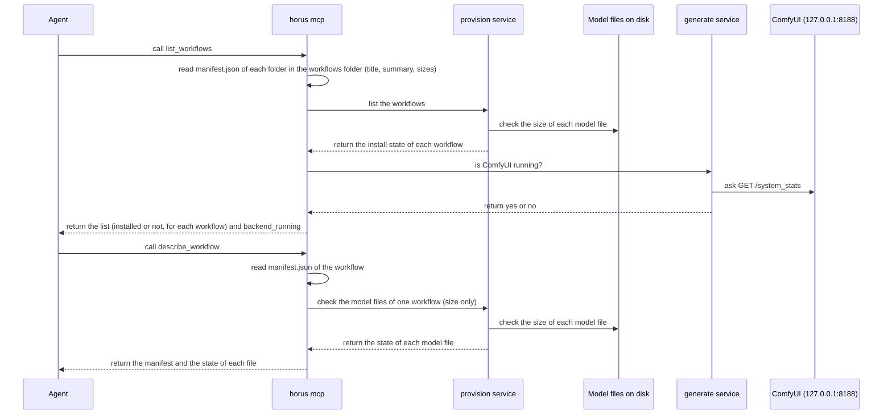
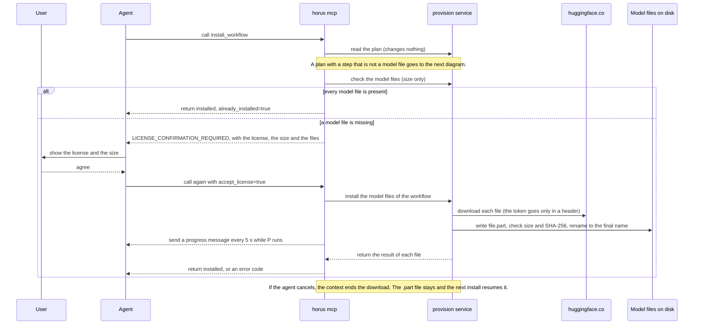
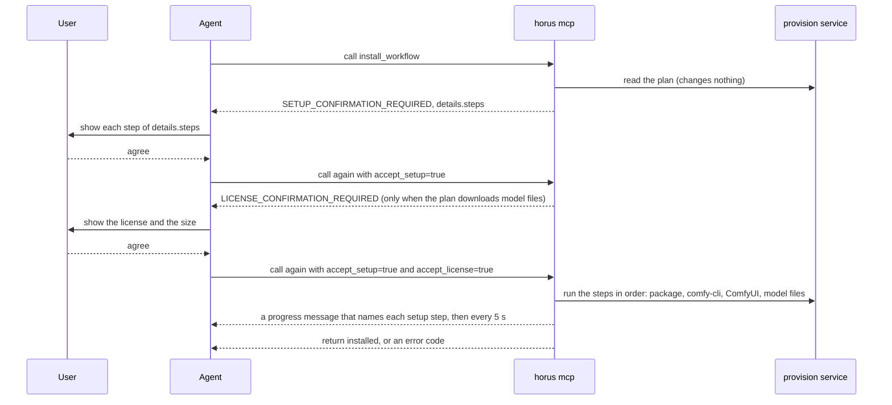
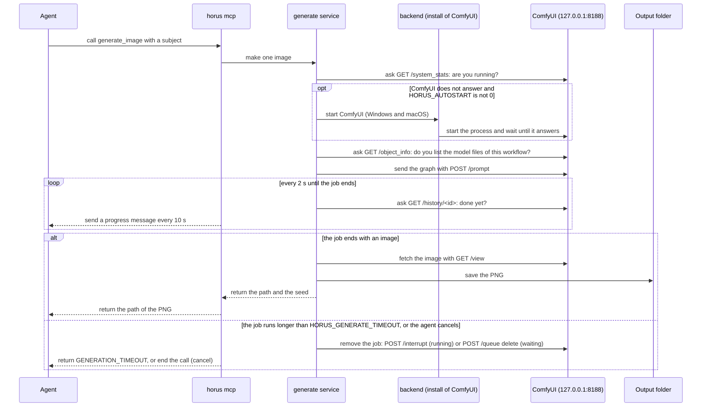

# horus as an MCP server

The horus MCP server lets any AI agent on this PC make an image with a named
workflow. The agent calls five tools. It does not need to know ComfyUI, the
model files, the graph or the GPU.

Terms:

- **MCP (Model Context Protocol):** the standard way for an agent to call the tools of another program.
- **stdio:** the agent harness starts the server as a child process and sends messages through its standard input and output. Nothing listens on the network.
- **Workflow:** one model and what it makes, a folder under `workflows/`. A workflow has a kind: `image` (a model and its ComfyUI graph) or `speech`. A workflow has no style of its own. The server offers each folder that has a `manifest.json`.
- **Envelope:** the one result shape that every tool returns (below).

The server is one process: `horus mcp`. It starts no other horus process.
Inside this one process, the code has three layers. A **handler**
(`internal/mcpserver`) receives the tool call. A **service** does the job. An
**adapter** talks to one outside thing. The handler calls a service. The service
calls an adapter through an interface that the service declares. No call goes
the other way. The spec
[`docs/specs/2026-11-11-restructure.md`](specs/2026-11-11-restructure.md) gives
the full rules, and `go test ./internal/archtest` enforces them.

Five parts take part in the diagrams below.

- The **agent** calls the tools.
- **`horus mcp`** is the handler. It answers the agent.
- The **provision service** (`internal/provision`) sets up the model files of a workflow. It lists, checks, installs and removes them.
- The **generate service** (`internal/generate`) makes one image.
- **ComfyUI** is the program that makes the picture.

The adapters are `internal/modelfiles` (the model files on the disk),
`internal/download` (the download from huggingface.co), `internal/comfy` (the
ComfyUI client) and `internal/backend` (the install of ComfyUI).

Each diagram below is one thing that an agent asks for, in order from top to
bottom. A line is an action, named by what it does.

### 1. The agent asks what horus can do (`list_workflows`, `describe_workflow`)



### 2. The agent installs the model files (`install_workflow`)



On a machine without ComfyUI, `install_workflow` first runs the plan of
`horus setup` (the spec
[`2026-11-15-release-install.md`](specs/2026-11-15-release-install.md),
"Setup through MCP"). The plan can have a system package step (7-Zip with
`winget` on Windows, Python 3.12 with `brew` on macOS), a comfy-cli step
(macOS), a ComfyUI step and the model files. The tool asks two consents, in
this order, and changes nothing before both:



- `details.steps` lists each step of the plan: `kind` (`package`, `comfy-cli`, `backend` or `file`), `name` (what the step installs), `command` (the program and its arguments of a package step, else `null`) and `dir` (the folder that the step writes to).
- One setup consent covers each step of `details.steps`, also the package steps.
- When the package manager is not found, a person must install the package. The tool then answers `BACKEND_NOT_INSTALLED`, and its `next_step` names the package and where to get it. It changes nothing.
- When a setup step fails, the tool answers `BACKEND_NOT_INSTALLED` with the failed step in `details.step` and the last lines of its output in `details.output_tail`. The next steps do not run.
- On a machine where ComfyUI is installed, the plan has only model files, and the tool gives the same answers as before. `accept_setup` changes nothing there.

`uninstall_workflow` works the same way: the provision service refuses a file
that another workflow lists, then the model files adapter deletes the files.

### 3. The agent makes a picture (`generate_image`)



In this diagram the generate service never calls the provision service: a
picture needs the model files to be installed already. If ComfyUI does not list
them, the call returns `WORKFLOW_NOT_INSTALLED`, which tells the agent to run
`install_workflow` first. The backend starts ComfyUI so that it keeps running
after `horus mcp` ends. `horus stop-comfyui` stops it.

## Install and connect

Install the program with the install line of the [README](../README.md#install-horus) or of [step 0 of `setup.md`](setup.md#step-0-install-the-horus-program). Then run:

```
horus register
```

- `horus register -client codex` registers the server with Codex instead of Claude Code.
- A developer of this repo builds the program with `go install ./cmd/horus`. The Go bin folder must be on the PATH: see [`setup.md`](setup.md#build-horus). After a `git pull`, run `go install ./cmd/horus` again.
- In this repo, `.mcp.json` names the server as the command `horus` with the argument `mcp`, so an agent here finds it without `horus register`.
- The same `.mcp.json` starts the comfy MCP server as `horus comfy-mcp`, on Windows and on macOS. `horus comfy-mcp` runs the program `comfy-mcp` of the venv of `horus install-comfy-mcp` (`<home>/.venvs/comfy-mcp`), else the `comfy-mcp` of the PATH, over the same standard input and output. It sets `PYTHONUTF8=1` and `PYTHONIOENCODING=utf-8`, and `COMFY_BIN` to the `comfy` next to comfy-mcp when that program exists and `COMFY_BIN` is not set. Its exit code is the exit code of comfy-mcp. When it finds no comfy-mcp, it writes `comfy-mcp was not found in ... Fix: horus install-comfy-mcp` to the standard error and exits 1.
- `horus register` adds the server `horus` to Claude Code. It runs `claude mcp add --scope user horus -- <path of horus> mcp`. In a clone it also passes `-e HORUS_ROOT=<clone>`. Then agents in every folder of this PC see the tools. Start a new Claude Code session after it.
- `horus register -client codex` adds the server to Codex. It runs `codex mcp get horus`. When that exits 0, it prints a `SKIP` line. Else it runs `codex mcp add horus -- <path of horus> mcp`, with `--env HORUS_ROOT=<clone>` in a clone. `-client claude` is the default. Another client name exits 2 and lists `claude, codex`.
- `<repo root>` is the absolute path of the horus clone that holds the current folder, or the folder of `-root <repo folder>` (it must have `workflows/`). With no clone and no `-root`, the program has no repo root: `horus register` still works and passes no `HORUS_ROOT`. Use `-horus-path <path>` to register another `horus` program.
- Another harness (an IDE) needs one stdio server entry: command `horus` (or its full path), argument `mcp`, and `HORUS_ROOT` when it starts outside this repo.

The server finds the repo through `HORUS_ROOT`, then the nearest folder at or
above the current folder that is a horus clone (a folder with
`workflows/_template/README.md`). Without a clone, the program uses its
built-in workflows: the build puts the workflow folders into the program, and
the program copies them to `<user folder>/builtin-workflows`. The user folder
is `HORUS_HOME`, default `<home>/horus`. It holds `.env` and `outputs/` when
there is no repo. It needs ComfyUI and the setup of [`setup.md`](setup.md). When ComfyUI
does not answer, `generate_image` starts it in the same way as `horus start-comfyui`
(the backend of `internal/backend`, in the process of the server).
`horus stop-comfyui` stops a ComfyUI that horus started, and no other one. The
backend writes the file `horus-comfyui.state.json` in the install folder when
it starts ComfyUI, and `horus stop-comfyui` reads it.

## The tools

| Tool | Does | Changes the PC |
|---|---|---|
| `list_workflows` | Lists the workflows: name, `kind` (`image` or `speech`), summary, `good_for`, `not_good_for`, default size, measured time, `install_state`. | No |
| `describe_workflow(workflow)` | One workflow in full, with its `kind`. An image workflow shows size limits and how to write the subject (rules and examples). A speech workflow shows `text` (limits), `voices`, `default_voice`, `tags` and `formats`, and no graph. Both show the license and the state of each model file. | No |
| `install_workflow(workflow, accept_license=false, accept_setup=false)` | Downloads and verifies the model files. Without `accept_license=true` it returns `LICENSE_CONFIRMATION_REQUIRED` with the license and the size. On a machine without ComfyUI it first runs the setup plan: without `accept_setup=true` it returns `SETUP_CONFIRMATION_REQUIRED` with the steps. | Yes: downloads GB, installs ComfyUI and a system package |
| `uninstall_workflow(workflow, confirm=false, remove_shared=false)` | Deletes the model files. Without `confirm=true` it returns `CONFIRMATION_REQUIRED` with the plan. A file that another workflow lists is kept unless `remove_shared=true`. | Yes: deletes files |
| `generate_image(workflow, subject, out_path?, seed?, width?, height?, overwrite=false)` | Makes one PNG and waits until it is on disk. Returns the absolute path and the seed. | Writes one PNG |

`generate_image` accepts a workflow of the kind `image` only. With a workflow of the kind `speech` it answers `INVALID_ARGUMENT`, and `next_step` names `generate_speech`.

The subject is the whole prompt. The server sends it to the model exactly as
written and adds nothing. The caller owns the look: style, palette, light,
composition and design system. A workflow never adds a style. The server
refuses a `manifest.json` that has `theme` or `caption`, and
`tests/mcp_contract.py` checks that the caption equals the subject.

`out_path` must be absolute and end with `.png`. Without it, the PNG goes to
`HORUS_OUTPUT_DIR` (default `.scratch/outputs/<workflow>/` in this repo, or
`<user folder>/outputs/<workflow>/` without a repo). The
server never replaces a file unless `overwrite=true`.

## The envelope

Every tool returns the same shape, in `structuredContent` and as JSON text in
`content`. A failed call also sets `isError`.

```json
{"ok": true, "result": {"path": "D:\\out\\cover.png", "seed": 7, "seconds": 241.3, "...": "..."}, "error": null}
```

```json
{"ok": false, "result": null, "error": {
  "code": "WORKFLOW_NOT_INSTALLED",
  "message": "the backend does not list model files of this workflow",
  "retryable": false,
  "action_by": "caller",
  "next_step": "Call install_workflow with workflow='it-illustration', then call generate_image again.",
  "details": {"missing": ["flux2-vae.safetensors"]}}}
```

A caller decides from three fields:

- `retryable`: `true` means that the same call can pass when it is sent again.
- `action_by`: `retry` (send the same call again), `caller` (change the arguments), `human` (the user must act first).
- `next_step`: one sentence that names the next action.

## Error codes

The single source is the Go package `internal/herr`. It has 22 codes. `horus errors` prints the table, and `horus errors -json` prints it as JSON. The contract test reads `horus errors -json` and fails when this table misses a code.

| Code | Retryable | Action by | Next step |
|---|---|---|---|
| `INVALID_ARGUMENT` | no | caller | Fix the argument named in `details.field`, then call again. `details` gives the limits. |
| `WORKFLOW_NOT_FOUND` | no | caller | Call `list_workflows` and use one of the names in `details.known`. |
| `WORKFLOW_NOT_INSTALLED` | no | caller | Call `install_workflow` for this workflow, then call `generate_image` again. |
| `LICENSE_CONFIRMATION_REQUIRED` | no | human | Show the license and the download size to the user. When the user agrees, call `install_workflow` again with `accept_license=true`. |
| `SETUP_CONFIRMATION_REQUIRED` | no | human | Show each step in `details.steps` to the user. When the user agrees, call `install_workflow` again with `accept_setup=true`. |
| `CONFIRMATION_REQUIRED` | no | human | Show the plan in `details.files` to the user. When the user agrees, call again with `confirm=true`. |
| `OUTPUT_EXISTS` | no | caller | Pass another `out_path`, or pass `overwrite=true`. |
| `BACKEND_UNAVAILABLE` | yes | human | ComfyUI does not answer and horus could not start it. The user runs `horus start-comfyui` and reads [`setup.md`](setup.md). |
| `BACKEND_NOT_INSTALLED` | no | human | The user sets up horus on this PC: [`setup.md`](setup.md). |
| `BACKEND_RESTART_REQUIRED` | yes | human | ComfyUI must restart to see new model files. The user restarts it, then the caller calls again. |
| `NODE_PACK_MISSING` | no | human | ComfyUI lacks a custom node pack that the workflow needs (`details.missing`). The user installs it. |
| `HF_TOKEN_INVALID` | no | human | Hugging Face answered HTTP 401. The user puts a valid Read token in `HF_TOKEN` in `.env`. |
| `LICENSE_NOT_ACCEPTED` | no | human | Hugging Face answered HTTP 403. The user opens `details.license_url` and accepts the license. |
| `DISK_FULL` | no | human | Not enough free disk space. The user frees space. |
| `FILE_CONFLICT` | no | human | A different file with the same name is on disk (`details.path`). horus never overwrites or deletes it. The user moves or deletes it. |
| `FILE_IN_USE` | yes | human | Windows does not let horus delete a model file that ComfyUI has open. The user stops ComfyUI, then the caller calls again. |
| `DOWNLOAD_FAILED` | yes | retry | Call `install_workflow` again. It resumes the partial download. |
| `OUT_OF_MEMORY` | yes | caller | The GPU ran out of memory. Call again. If it fails again, use a smaller width and height. |
| `GENERATION_FAILED` | yes | retry | Call again with the same arguments. If it fails twice, report `details.backend_message` to the user. Some causes are not retryable; then `retryable` is `false` and `next_step` says why. |
| `GENERATION_TIMEOUT` | yes | retry | The job ran longer than `HORUS_GENERATE_TIMEOUT` (default 1800 s). horus removed it from the ComfyUI queue. Call again later. |
| `CANCELLED` | yes | retry | Someone cancelled the job in ComfyUI. Call again if the image is still needed. |
| `INTERNAL` | no | human | A defect in horus or in a workflow. Report `details` to the user. |

## Long calls

`generate_image` is a direct call: it returns when the PNG is on disk. One
image takes 3 to 8 minutes on a 6 GB GPU, and longer when ComfyUI must start
and load 11 GB of model files first. `install_workflow` can take an hour.

What the harness does with a long call (Claude Code docs, read 2026-11-06,
https://code.claude.com/docs/en/mcp.md):

- A call in the main conversation that runs longer than 2 minutes moves to a background task. The agent gets a task id at once, continues with other work, and gets the result as a notification. `CLAUDE_CODE_MCP_AUTO_BACKGROUND_MS` changes the 2 minutes.
- The default tool-call time limit is about 28 hours (`MCP_TOOL_TIMEOUT`).
- A stdio call that sends no result and no progress for 30 minutes is stopped (`CLAUDE_CODE_MCP_TOOL_IDLE_TIMEOUT`). horus sends a progress notification every 10 s while it waits for an image, and every 5 s while it downloads. A progress notification needs a `progressToken` from the caller.
- Measured 2026-11-10: headless Claude Code 2.1.322 (`claude -p --mcp-config <file> --strict-mcp-config`) sends a `progressToken` in `tools/call`. The server log shows `call generate_image progress_token=2`, then one `progress` line every 10 s for 211 s. An older measurement (2026-11-06, Claude Code 2.1.318) showed `progress_token=None`, so update an older Claude Code. An interactive session is not measured.
- Not verified: that a progress notification resets the 30-minute idle timer of 2.1.322. The docs say only that a call stops after 30 minutes with "no response and no progress notification". No `install_workflow` run of more than 30 minutes is measured. So for a long install, keep `CLAUDE_CODE_MCP_TOOL_IDLE_TIMEOUT=0`, or run `horus workflow install <name>` once by hand.
- In `claude -p` (headless), a backgrounded call loses its result when the run ends. A headless caller must wait for the call.

Because of the automatic background move, a synchronous tool does not block a
Claude Code agent. MCP tasks (a server-side job id with polling) are a later
step; see [`ROADMAP.md`](../ROADMAP.md).

## Add a workflow to the server

The server offers a workflow when its folder has `manifest.json`. Copy
[`workflows/it-illustration/manifest.json`](../workflows/it-illustration/manifest.json)
and change every field. The fields:

| Field | What it is |
|---|---|
| `name` | Must equal the folder name. |
| `kind` | `image` or `speech`. Without it the kind is `image`. Any other value is refused. |
| `title`, `summary`, `good_for`, `not_good_for` | What the caller reads to choose a workflow. Write what the model can and cannot draw. Do not describe a look: the caller owns the look. |
| `output` | `default_width`, `default_height`, `min_side`, `max_side`, `multiple_of`. Set `max_side` to a size that you ran on the target GPU. |
| `subject` | `min_chars`, `max_chars`, `how_to_write`, `rules`, `examples` (subject, image, seed). The caller writes the subject from these. |
| `timing` | Measured seconds per image and the hardware. |
| `graph.file`, `graph.node_count` | The UI-format graph and its node count. A different count after conversion stops the run. |
| `graph.inputs` | For each of `caption`, `seed`, `width`, `height`, `filename_prefix`: the node class and the input name that horus sets. Exactly one node of that class must exist. |

The caller never sees `graph`: `describe_workflow` leaves it out.

A manifest of the kind `speech` has no `graph`, no `subject` and no `output`: the server refuses a speech manifest that has one. It has these fields instead:

| Field | What it is |
|---|---|
| `name`, `title`, `summary` | As for an image manifest. `good_for`, `not_good_for` and `timing` are optional. |
| `text` | The limits of the text: `min_chars`, `max_chars`, and how to write it. |
| `voices`, `default_voice` | The voice names, not empty. `default_voice` is one of them. |
| `tags` | The `[tag]` markers that the model performs. |
| `formats` | The audio formats of the result. |

Also add the folder name to the `go:embed` line of
[`workflows/embed.go`](../workflows/embed.go). The release program holds only
the folders on that line. `go test ./workflows` fails when a folder with a
`manifest.json` is not on it.

## Settings

Each setting is an environment variable or a line in `.env`. The environment wins.
`.env` is `<repo root>/.env`, or `<user folder>/.env` when there is no repo root.

| Setting | Default | What it does |
|---|---|---|
| `HORUS_ROOT` | the nearest folder at or above the current folder with `workflows/_template/README.md`; none outside a clone | The repo root, where horus reads `workflows/` and `.env`. Set it when the server must use a repo but starts outside it. Only the environment sets it, not `.env`. |
| `HORUS_HOME` | `<home>/horus` | The user folder: `.env` and `outputs/` without a repo root, and the copy of the built-in workflows. Only the environment sets it, not `.env`. |
| `HORUS_COMFYUI_URL` | `http://127.0.0.1:8188` | The ComfyUI address. `horus doctor`, `horus start-comfyui` and `horus stop-comfyui` also use it when they get no `-server-url`. |
| `HORUS_COMFYUI_DIR` | Windows: `%USERPROFILE%\ComfyUI_windows_portable`. macOS: `~/horus`. | The install folder of ComfyUI. ComfyUI itself is in its subfolder `ComfyUI`. |
| `HORUS_OUTPUT_DIR` | `.scratch/outputs` in this repo, else `<user folder>/outputs` | Where a PNG goes when the call has no `out_path`. |
| `HORUS_AUTOSTART` | `1` | `0`: never start ComfyUI; return `BACKEND_UNAVAILABLE`. |
| `HORUS_GENERATE_TIMEOUT` | `1800` | Seconds before horus cancels a job and returns `GENERATION_TIMEOUT`. |
| `HORUS_WORKFLOWS_DIR` | `workflows` in this repo, else the copy of the built-in workflows | Another workflows folder (tests use it). It replaces the built-in workflows. `horus workflow`, `horus setup` and `horus doctor -workflow` also use it. |
| `HORUS_LOG_FILE` | none | Also write the server log to this file. Each call logs its tool name and its `progressToken`. |

Only the code of `internal/download` reads `HF_TOKEN`, and `go test ./internal/archtest`
enforces that. It reads the environment variable first, then the line in the `.env` file of the
repo root. It sends the token only to `huggingface.co` hosts. The server runs the download in its own
process, so the token is in the memory of `horus mcp` while an install runs. The server starts no program that gets the token.

## Test the server

The test tools are Python programs for developers. `horus` itself needs no Python.
Make a Python virtual environment (venv) with Python 3.12 and the MCP client, one time:

```
py -3.12 -m venv .scratch\test-venv
.scratch\test-venv\Scripts\python -m pip install -r tests\requirements.txt
```

On macOS and Linux, use `python3.12 -m venv .scratch/test-venv` and
`.scratch/test-venv/bin/python`. Then, with `horus` on the PATH (see
[`setup.md`](setup.md#build-horus)):

```
.scratch\test-venv\Scripts\python tests\mcp_contract.py
.scratch\test-venv\Scripts\python tests\mcp_contract.py --server-cmd bin\horus.exe mcp
```

The first command tests `horus mcp` from the PATH. The second tests another build.
The contract test starts the server over stdio with the official MCP client.
A fake ComfyUI in the test process answers, so it needs no GPU and no network.
It checks the tools, the schemas, the envelope, each main error code, the
caption, cancel on timeout, and install and uninstall on stand-in model files.
It also starts the server two more times on a machine without ComfyUI: once
without a package manager, and once with a fake package manager (`winget` on
Windows, `brew` on macOS) that installs nothing. The PATH of the server then
holds only the fake programs and the folders of the OS, and the proxy settings
name a closed port, so no real package manager runs and no download leaves the
machine. These checks prove the setup consent: no change on disk before
`accept_setup=true`, the order of the two consents, and the package step with
the arguments of the spec.
It ends with `contract: N of M passed` and exits 0 only when all pass.
The total M is 38 server checks plus 2 for each shipped workflow. The second
check of a workflow depends on its kind: an image workflow has no style words in
its graph, and a speech workflow has no graph, no subject and no output.

### The peak tool

`tests/peak_load.py` measures what happens when many agents call
`generate_image` at the same time. It starts one `horus mcp` process for each
call, and a fake ComfyUI in its own process answers. The fake runs one job at a
time (`--parallel`) and holds the others in its queue. It needs no GPU.

```
.scratch\test-venv\Scripts\python tests\peak_load.py --target host --server-cmd bin\horus.exe mcp --calls 12 --leave 3,6
```

- `--scale` (default 10) divides every time. One image takes 240 / scale
  seconds. The tool sets `HORUS_GENERATE_TIMEOUT` and `HORUS_QUEUE_TIMEOUT` to
  1800 / scale and 7200 / scale.
- `--leave 3,6 --leave-at 60` ends the server process of the calls 3 and 6 at
  once, 60 / scale seconds after the calls start. This is an agent that leaves.
- `--target stack --stack <name>` starts `docker exec -i <name>-api horus mcp`.
- The last line of stdout is one JSON line: `png`, `generation_timeout`,
  `queue_full`, `wait_for_error_seconds`, `gpu_seconds_for_nobody`,
  `max_jobs_in_comfyui` and `max_running`. Seconds are wall-clock seconds.
  `gpu_seconds_for_nobody` counts the seconds that the fake ran a job of a call
  that had left, from the time that the call left.
- The exit code is 0 when the run ended, whatever the numbers. `--log` names the
  file with one line for each request of the fake.
