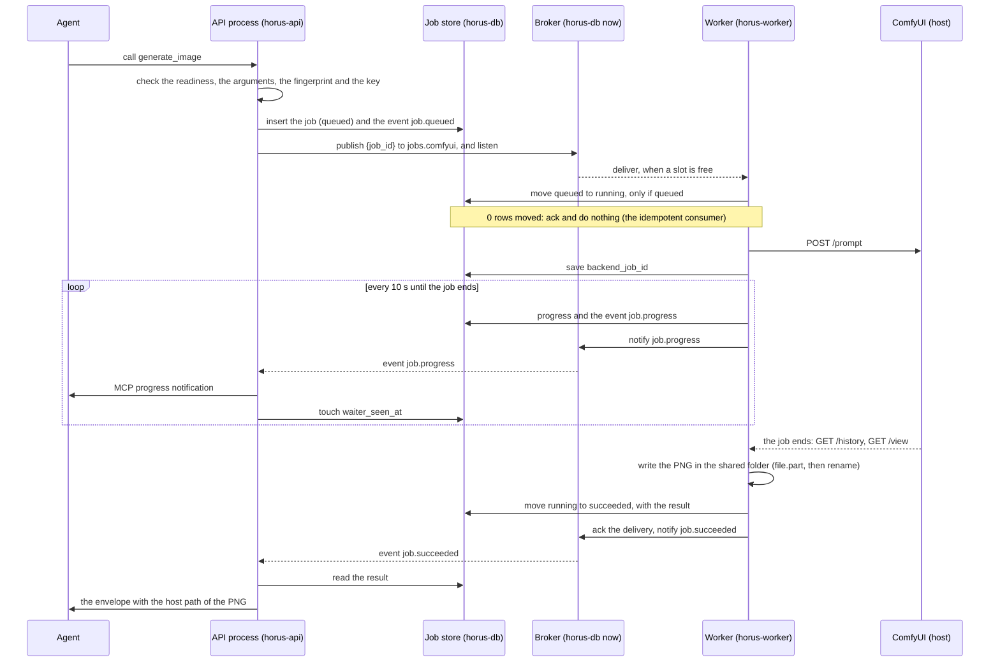
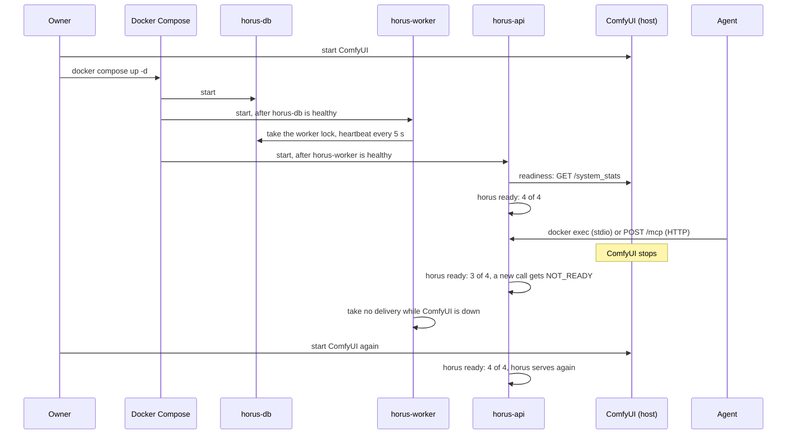

# Spec: the job queue, a Docker stack with a message broker and one worker

Date: 2026-11-19 (the brainstorm) and 2026-11-20 (the ratification). The epic:
[issue #180](https://github.com/hieplam/horus/issues/180). The decision records:
[ADR 0025](../adr/0025-run-each-job-through-a-broker-and-one-worker.md),
[ADR 0026](../adr/0026-the-broker-is-an-interface-postgres-first.md),
[ADR 0027](../adr/0027-the-idempotency-key-and-the-idempotent-consumer.md),
[ADR 0028](../adr/0028-the-horus-ui-is-a-read-only-page-of-horus-api.md),
[ADR 0029](../adr/0029-horus-runs-as-a-stack-of-three-containers.md) and
[ADR 0030](../adr/0030-horus-api-serves-mcp-over-stdio-and-http.md). The
reference of the Horus UI:
[`2026-11-19-job-queue-ui.html`](2026-11-19-job-queue-ui.html).

## What this work delivers

At peak time, many agents call `generate_image` at the same time. Today each
agent session has its own `horus mcp`, and each one sends its job to ComfyUI
at once. The 1800 s limit counts the wait in the ComfyUI queue, so late calls
end with `GENERATION_TIMEOUT`.

After this work, horus runs as a Docker stack of 3 containers next to the
ComfyUI of the host:

- `horus-api` takes the calls of the agents, over stdio or over HTTP.
- `horus-db` (Postgres 18.6) holds the job store and the broker.
- `horus-worker` runs at most `HORUS_WORKER_CONCURRENCY` jobs at a time on
  ComfyUI.

horus serves only when its 4 dependencies are up: the 3 containers and
ComfyUI. The owner runs the stack and ComfyUI, and manages the readiness. A
read-only page, the Horus UI, shows the readiness, the queue, the running job,
the recent results, the worker and the workflows. For an agent,
`generate_image` keeps its contract.

## Terms

- **Stack:** the 3 containers of `compose.yaml`: `horus-api`, `horus-worker`
  and `horus-db`.
- **API process:** the code in `horus-api` that serves one agent session. Over
  stdio, one `horus mcp` process that `docker exec -i horus-api horus mcp`
  starts. Over HTTP, one MCP session of `horus api`.
- **Worker:** `horus worker`, the main process of `horus-worker`. It takes
  deliveries from the broker and runs the jobs.
- **ComfyUI:** the ComfyUI of the host, as today. A container reaches it at
  `host.docker.internal:8188`. The owner starts it.
- **Ready:** the 3 containers pass their checks, and ComfyUI answers.
  `horus ready` prints the 4 checks.
- **Direct path:** what `horus mcp` does on the host without
  `HORUS_DATABASE_URL`: it calls ComfyUI itself, as today.
- **Job:** one request for one output. One row in `horus.jobs`.
- **Job store:** the Postgres tables of the jobs, their states and their
  events. The record of truth.
- **Broker:** the Go interface `Broker`, which moves messages to the worker and
  events back. Now Postgres. Later RabbitMQ.
- **Message:** a small record in a work queue of the broker: `v`, `job_id`,
  `tool` and `backend`.
- **Work queue:** a named list of messages, one for each backend, for example
  `jobs.comfyui`.
- **Delivery, ack, prefetch:** the broker gives a message to the worker (a
  delivery). The worker sends an ack when the job ends, and the broker deletes
  the message. The prefetch is the most deliveries without an ack. It equals
  the number of slots.
- **At-least-once:** a broker can deliver one message two times.
- **Idempotent consumer:** the worker runs a delivery only when the job store
  moves the job from `queued` to `running`.
- **Slot:** a place in the worker for one running job.
- **Deadline:** the insert time plus `HORUS_QUEUE_TIMEOUT`. A queued job after
  its deadline never starts.
- **Waiter:** the API process that waits for one job. It writes
  `waiter_seen_at` every 10 s.
- **Request fingerprint, idempotency key, dedupe:** see
  [ADR 0027](../adr/0027-the-idempotency-key-and-the-idempotent-consumer.md).
- **Shared folder:** a host folder of `HORUS_SHARED_DIRS` that the stack
  mounts into `horus-api` and `horus-worker`.
- **Peak tool:** `tests/peak_load.py`. It starts 12 MCP clients against a fake
  ComfyUI: on the host, or into the stack. It divides every time by 10: an
  image takes 24 s, and the limits shrink in the same way.

## Ratified goal (owner, 2026-11-20)

| Row | Outcome | Oracle | Threshold | Ratchet |
|---|---|---|---|---|
| `peak-timeouts` | 12 agents call `generate_image` at the same time, and the agents of 2 calls leave after 1 minute. Each agent that stays gets its PNG. No call ends with `GENERATION_TIMEOUT`, and no GPU time goes to a job whose agent left. | The peak tool against the stack with the fake ComfyUI. Its JSON line gives the counts. | 10 of 10 PNG. 0 `GENERATION_TIMEOUT`. 0 GPU seconds for nobody. | `GENERATION_TIMEOUT`: today's count → 0. GPU seconds for nobody: today's count → 0. |
| `bounded-backend-queue` | In the same run, ComfyUI never holds more horus jobs than the slots. | The fake ComfyUI of the peak tool records the most jobs that it held, running and waiting. | Most jobs = 1, with 1 slot | Most jobs in ComfyUI at one time: today's count → 1 |
| `stack-starts-together` | One command, `docker compose up -d`, starts the 3 containers in their order, and horus becomes ready when ComfyUI answers. | End-to-end run of the profile `test`: read the health in `docker compose ps`, then run `horus ready` in `horus-api`. | 3 healthy, and `horus ready` exits 0, in 120 s or less | Containers healthy after one command: 0 → 3 |
| `ready-when-four-up` | horus serves only while its 4 dependencies are up. When one is down, a new session cannot start over stdio or over HTTP, and a call gets `NOT_READY` that names it. When it is up again, horus serves again with no action on horus. | End-to-end run: stop each of the 3 containers in turn, then the fake ComfyUI, then the whole stack. Each time, start a stdio session and an HTTP session, send a call, then start the part again. | 4 of 4 dependencies named in 10 s or less. Ready again in 30 s or less after the part is up. 0 requests reach ComfyUI while horus is not ready. | Dependencies whose stop horus finds: 0 → 4 |
| `out-path-mapping` | An agent gives a host path in a shared folder: the PNG is at that host path, and the result gives the host path. A path outside the shared folders gets `INVALID_ARGUMENT` that lists them. | End-to-end run on the stack with two calls. | 2 of 2 cases | Cases that pass: 0 → 2 |
| `concurrency-setting` | `HORUS_WORKER_CONCURRENCY` = N runs at most N jobs at the same time, and it reaches N. | The peak tool with N = 1, 2 and 3. The fake ComfyUI records the most jobs that run at the same time. | Most jobs at one time = N, for each N | Values of N that pass: 0 → 3 |
| `broker-contract` | The in-memory broker and the Postgres broker behave the same for each method of `Broker`. | `go test ./internal/brokertest/...` runs one suite on both brokers. | Every check passes on both | Brokers that pass: 0 → 2 |
| `duplicate-delivery` | A message that comes two times makes one ComfyUI job. | A Go test of `internal/worker`: the in-memory broker delivers each of 6 messages two times, and the fake ComfyUI counts submits. | 6 submits for 6 jobs | Jobs with exactly one submit: 0 → 6 |
| `same-contract` | An agent sees the same tools on the host, over stdio into the stack, and over HTTP. | `tests/mcp_contract.py` three times: on the direct path of the host (Windows and macOS in CI, as today), over stdio through `docker exec`, and over HTTP to `/mcp`. The two runs on the stack use the fake ComfyUI (Linux in CI). | All checks pass in the 3 runs | Checks that pass on the stack: 0 → all, for each of the 2 ways |
| `http-guard` | Only a local agent with the token can use `/mcp`. A web page in a browser cannot. | End-to-end run against the stack: a request without a token, one with a wrong token, one with a wrong `Host`, one with a foreign `Origin`, then one right request. | 401, 401, 403, 403, then 200 | Bad requests refused: 0 → 4 |
| `queue-progress` | A waiting call gets its place in the queue and its estimated start as progress. | The contract test reads the progress messages of the third of 3 calls. | "position 2 of 2" or less, with a start time, at least every 10 s | Calls with a position message: 0 → 3 |
| `cancel-and-deadline` | A cancel removes a queued job before ComfyUI sees it. A call whose estimated start is after `HORUS_QUEUE_TIMEOUT` gets `QUEUE_FULL` at once. A job past its deadline never starts. | End-to-end run. The fake ComfyUI counts submits. | 0 submits for those jobs. `QUEUE_FULL` in less than 2 s. | Submits of jobs that nobody wants: today's count → 0 |
| `worker-lost` | The worker stops while a job runs. The waiting call gets `WORKER_LOST`, Docker restarts `horus-worker`, and the next job runs. | End-to-end run with `docker kill` of `horus-worker` during a job. | `WORKER_LOST` in 90 s or less. The next job ends with a PNG. | Calls that end with `WORKER_LOST`: 0 → 1 |
| `idempotency-recorded` | Each job row holds the fingerprint and the key of recipe version 1. The dedupe is off: two equal calls make two jobs. | A Go test of the pure function with 12 fixed vectors, and an end-to-end run that reads the rows. | 12 of 12 vectors. 2 rows with the same key. | Vectors that pass: 0 → 12 |
| `ui-matches-mockup` | The Horus UI shows the 11 parts of the reference, with the counts of the job store and the state of the 4 dependencies. | The example data of the reference goes into a test database. A headless Edge or Chrome takes a screenshot at 1920 × 1080. An agent puts it next to a screenshot of the reference and judges each part. The JSON summary equals SQL counts. | 11 of 11 parts. All counts equal. | Parts that match: 0 → 11 |

The ratchets marked "today's count" start from the numbers that the peak tool
measures on `main` before the build, on the direct path. The task that commits
the tool writes those numbers into its pull request.

**Done** means: all 15 rows pass from
`go test -tags goal -v ./goals/2026-11-19-job-queue` on the PC, and the agent
acceptance on the PC finds no open defect. In the acceptance, the stack uses a
second ComfyUI on the host on port 8189, so the acceptance can stop and start
it. 3 real agent sessions (`claude -p`) connect, 2 over stdio and 1 over HTTP,
and call `generate_image` at the same time. They get 3 PNG files in a shared
folder. Each of the 4 dependencies is stopped one time, and horus refuses and
then serves again. The screenshot of the Horus UI stands next to the reference.

After this ratification, the owner is not asked to verify or decide anything.
A finding becomes an issue that blocks the task that it threatens.

## The design

The design document of the brainstorm has the diagrams with hover texts and
the charts: https://claude.ai/artifact/VnxPtMQtP7GoqKscVJmsVS (a private page
of the owner). This section is the part that later work must follow.

### The parts

| Part | Does | Never does |
|---|---|---|
| `horus-api` and its API processes | Checks the arguments and the readiness. Computes the fingerprint and the key. Inserts the job. Publishes one message. Listens to the events. Sends progress. Returns the envelope. `horus api` serves `/mcp`, the Horus UI and `/readyz`. | Calls ComfyUI for a job. |
| Broker (in `horus-db` now) | Keeps each message until its ack. Gives the worker at most prefetch deliveries. Delivers a message again when the worker stops before its ack. Sends events to the processes that listen. | Holds the arguments or the state of a job. Decides if a job runs. |
| Job store (in `horus-db`) | Holds the jobs, the events and the worker heartbeat. Moves a job to the next state only from the expected state. | Moves messages. |
| `horus-worker` | Takes deliveries into free slots while ComfyUI answers. Moves each job in the job store. Writes the PNG. Acks the delivery. | Answers an MCP call. Runs more jobs than it has slots. Starts ComfyUI. |
| ComfyUI (host) | Runs the graph on the GPU. The owner starts and stops it. | Holds more horus jobs than the worker has slots. |

### One job, step by step



When a NOTIFY is lost, each waiter also reads the job store every 5 s. So a
lost event delays a step by at most 5 s.

### Readiness

| Dependency | Check (every 5 s) | Starts after | When it is down |
|---|---|---|---|
| `horus-db` | Health check: `pg_isready`, and the schema has the version of the program | nothing | No job store and no broker |
| ComfyUI (host) | `GET http://host.docker.internal:8188/system_stats` answers 200 in 2 s | the owner starts it | No image. The worker takes no delivery, so queued jobs keep their place. |
| `horus-worker` | Health check: its row in `horus.workers` has a heartbeat newer than 15 s, and it holds the worker lock | `horus-db` is healthy | No job runs |
| `horus-api` | Health check: `horus ready`, all 4 checks pass | `horus-db` and `horus-worker` are healthy | Agents can connect in neither way |



What an agent sees:

- Docker is down, or `horus-api` is stopped: `docker exec` fails, and port
  8190 does not answer. The harness shows horus as failed.
- A new session while a dependency is down: a stdio session prints the failed
  check and exits. `/mcp` answers 503 with the same report.
- A call in an open session while a dependency is down: `NOT_READY`, with the
  down dependencies in `details.down`.
- The dependency is up again: horus serves again in 30 s or less.

### Two ways in

- Stdio: `docker exec -i horus-api horus mcp`. `horus register -docker` adds it.
- HTTP: Streamable HTTP to `http://127.0.0.1:8190/mcp`. `horus register -http`
  adds the URL, with a header that names the variable `HORUS_API_TOKEN` and not
  the token.
- `/mcp` refuses a wrong `Host` or `Origin` header with 403, and a request
  without the right bearer token with 401. The stack publishes the port only
  on 127.0.0.1.
- Both ways give the same tools and the same envelope.

### The broker interface

The service `internal/jobs` declares the two interfaces. The data types are in
the base package `internal/jobdata`, so that the adapter does not import the
service.

```go
// Broker moves messages and events. internal/postgres implements it now.
type Broker interface {
    Publish(ctx context.Context, queue string, m jobdata.Message) error
    // Consume gives at most prefetch messages without an ack.
    // A message can come two times (at-least-once).
    Consume(ctx context.Context, queue string, prefetch int) (<-chan jobdata.Delivery, error)
    // Notify sends an event to the processes that listen now. It keeps nothing.
    Notify(ctx context.Context, e jobdata.Event) error
    Listen(ctx context.Context) (<-chan jobdata.Event, error)
}

// Store keeps the jobs. It is the record of truth.
type Store interface {
    Insert(ctx context.Context, j jobdata.Job) error
    Get(ctx context.Context, id string) (jobdata.Job, error)
    // Move changes the state only from one of from, with its event, in one
    // transaction. false: the job was not in from.
    Move(ctx context.Context, id string, from []jobdata.State, to jobdata.State, c jobdata.Change) (bool, error)
    Touch(ctx context.Context, id string) error
    Position(ctx context.Context, id string) (pos, total int, err error)
    Queued(ctx context.Context) (int, error)
    Sweep(ctx context.Context) (expired, abandoned int, err error)
    Summary(ctx context.Context) (jobdata.Summary, error)
    WorkerLock(ctx context.Context) (release func(), err error)
}
```

`jobdata.Message` is `{v, job_id, tool, backend}`. `jobdata.Delivery` holds the
message and two functions, `Ack` and `Nack`. `jobdata.Event` is
`{v, job_id, type, at, seq}`, and `seq` is the row id in `horus.job_events`.

| Contract | Postgres broker (now) | RabbitMQ broker (later) |
|---|---|---|
| `Publish` | `INSERT` into `horus.messages`, then `NOTIFY horus_messages` | `basic.publish` to a durable queue, persistent |
| `Consume` | Up to prefetch rows with `FOR UPDATE SKIP LOCKED`, hidden for 60 s. It wakes on NOTIFY and reads every 5 s. | `basic.qos(prefetch)` and `basic.consume` with manual acks |
| A delivery that runs for minutes | The adapter extends the visibility time every 20 s | `consumer_timeout` must be more than `HORUS_GENERATE_TIMEOUT` |
| `Ack` / `Nack` | `DELETE` the row / make it visible again | `basic.ack` / `basic.nack` |
| The worker stops before the ack | The visibility time passes, and the row comes again | The channel closes, and the message comes again |
| `Notify` / `Listen` | `NOTIFY` / `LISTEN horus_events` (at most 8000 bytes) | Topic exchange `horus.events`, routing key `job.<type>` |

The queue position, a cancel of a queued job, `QUEUE_FULL`, expired and
abandoned jobs and the one-worker lock live in the job store. So they work
with any broker: the worker gets the message, finds the job not queued, acks
it and does nothing.

### Job states

`queued`, `running`, `succeeded`, `failed`, `cancelled`, `expired` and
`abandoned`. Only the worker moves a job from `queued` to `running`. The API
process moves a queued job to `cancelled` when the agent cancels. For a
running job, the API process writes `cancel_requested_at`. The worker sees it
at the event `job.cancel_requested` and at its read of the job store every 5 s.
Then it ends the run, ComfyUI gets the cancel of the job, and the worker moves
the job to `cancelled`. The sweep of
the worker (every 30 s, and at each delivery) sets `expired` after the deadline
and `abandoned` after 60 s with no waiter. The first version has no automatic
retry.

### Data in `horus-db`

- `horus.jobs`: `id` (UUIDv7), `tool`, `workflow`, `backend`, `work_queue`,
  `resource_key`, `payload`, `request_hash`, `idempotency_key`, `state`,
  `attempt`, `created_at`, `deadline`, `waiter_seen_at`, `started_at`,
  `finished_at`, `worker_id`, `backend_job_id`, `cancel_requested_at`,
  `progress`, `result`, `error`, `caller`. An index on
  `(idempotency_key, created_at)`.
- `horus.job_events`: `id`, `job_id`, `at`, `type`, `data`.
- `horus.workers`: `id`, `host`, `pid`, `version`, `slots`, `started_at`,
  `heartbeat_at`, `loaded_resource_key`.
- `horus.messages` (the Postgres broker only): `id`, `queue`, `body`,
  `created_at`, `visible_at`, `deliveries`.

The worker applies the schema at start under an advisory lock, and deletes
jobs and events older than `HORUS_JOB_RETENTION_DAYS` one time each day. The
data is in the volume `horus-db-data`. The driver is `github.com/jackc/pgx/v5`
(MIT).

### Idempotency

The recipe of the fingerprint and the key, and the rules of the dedupe for
later, are in
[ADR 0027](../adr/0027-the-idempotency-key-and-the-idempotent-consumer.md).
When the dedupe is on:

| The newest earlier job with the same key | The new call |
|---|---|
| queued or running, same fingerprint | Waits for that job and returns its result with `deduplicated: true` |
| succeeded less than 24 h ago, same fingerprint, the PNG is on disk | Returns its result at once |
| succeeded, but the PNG is gone or the job is older than 24 h | Makes a new job |
| failed, cancelled, expired or abandoned | Makes a new job |
| any state, different fingerprint (only with a caller key) | `IDEMPOTENCY_KEY_REUSED`, action by the caller |

### Settings

| Setting | Default | What it does |
|---|---|---|
| `HORUS_DATABASE_URL` | set by `compose.yaml` | The connection to `horus-db`. When it is set, the broker is on. Without it, the direct path. horus never writes its password part to a log or to the Horus UI. |
| `HORUS_COMFYUI_URL` | `http://host.docker.internal:8188` in the stack | The ComfyUI of the host, as a container sees it |
| `HORUS_MODELS_DIR` | none | The host folder of the model files that ComfyUI reads. The stack mounts it into `horus-api` for `install_workflow`. |
| `HORUS_SHARED_DIRS` | the horus outputs folder | The host folders where an agent can ask for a PNG. The stack mounts each one into `horus-api` and `horus-worker`. |
| `HORUS_WORKER_CONCURRENCY` | `1` | The number of slots, for all backends together. It is also the prefetch. |
| `HORUS_QUEUE_MAX` | `20` | The number of queued jobs at which a new call gets `QUEUE_FULL` |
| `HORUS_QUEUE_TIMEOUT` | `7200` | The longest wait in the queue, in seconds |
| `HORUS_GENERATE_TIMEOUT` | `1800` | Seconds from the start of the run of a job |
| `HORUS_API_PORT` | `8190` | The port of `/mcp`, the Horus UI and `/readyz`, on 127.0.0.1 only |
| `HORUS_API_TOKEN` | none | The bearer token of `/mcp`. Only in the `.env` of the stack and in the environment of an agent. |
| `HORUS_JOB_RETENTION_DAYS` | `30` | The age at which the worker deletes a job and its events |

### MCP contract

| Item | With the stack |
|---|---|
| `generate_image` arguments | The same, and the optional `idempotency_key`. An `out_path` must be in a shared folder. |
| `generate_image` result | `job_id` is the horus job id. `path` is the host path. New: `backend_job_id` and `queue_seconds`. |
| Progress text | "waiting in the horus queue, position 2 of 3, start in about 4 min", then the text of today |
| `list_workflows` result | Also `ready` (the 4 dependencies and their state) and `queue` (waiting, running, slots) |
| `install_workflow` | Only the model files, into `HORUS_MODELS_DIR` |
| `GENERATION_TIMEOUT` | Counts from the start of the run. A job that waits longer than `HORUS_QUEUE_TIMEOUT` never starts, and its call gets `GENERATION_TIMEOUT` with `details.phase` = `queued`. |

| New code | Retryable | Action by | Next step |
|---|---|---|---|
| `NOT_READY` | yes | human | A dependency of horus is down (`details.down`). Tell the user. The user starts it, then the caller calls again. |
| `QUEUE_FULL` | yes | retry | The queue holds `HORUS_QUEUE_MAX` jobs, or the estimated start is after the deadline. Call again after `details.retry_after_seconds`. |
| `WORKER_LOST` | yes | retry | The worker stopped while it ran the job. Call again. |
| `IDEMPOTENCY_KEY_REUSED` | no | caller | Later, with the dedupe. Use a new key for a different request. |

### The Horus UI

The reference is [`2026-11-19-job-queue-ui.html`](2026-11-19-job-queue-ui.html).
Its 11 parts: the readiness strip with the 4 dependencies; the tiles "waiting
in the queue", "running / slots", "succeeded today", "failed today" and
"workflows"; the panels "running", "queue", "recent", "worker" and
"workflows". The rules of the page are in
[ADR 0028](../adr/0028-the-horus-ui-is-a-read-only-page-of-horus-api.md). The
page shows the clock times of the time zone of the browser and the host path
of a PNG
([ADR 0043](../adr/0043-the-horus-ui-shows-the-times-of-the-browser-and-host-paths.md)).

### Code layout

| Item | Layer | Job |
|---|---|---|
| `compose.yaml` | deployment | The 3 containers, the health checks, the start order, `restart: unless-stopped`, the volume, the mounts, the one published port, and `host.docker.internal` on Linux. A profile `test` adds a fake ComfyUI container. |
| `docker/horus.Dockerfile` | deployment | One image with the Linux program `horus`, for `horus-api` and `horus-worker` |
| `internal/jobdata` | base | Job, State, Change, Message, Delivery, Event, Summary, and the readiness report as a pure function of the 4 checks |
| `internal/jobs` | service | The state rules, the recipe, the consumer rules, submit and wait, the delivery loop, the host and container paths. It declares `Broker` and `Store`. |
| `internal/postgres` | adapter | `Store` and `Broker` with pgx |
| `internal/brokertest` | test | The contract suite of `Broker`, and the in-memory broker |
| `internal/worker` | handler | The loop of `horus worker`: the slots and the heartbeat |
| `internal/webui` | handler | The page, the JSON summary, `/readyz` and the SSE stream |
| `internal/mcpserver` | handler | The handler of `/mcp`, the readiness checks, `generate_image` through the broker, `ready` and `queue` in `list_workflows` |
| `internal/generate` | service | The argument check apart from the run |
| `internal/cli`, `cmd/horus` | handler, wiring | `horus api`, `horus worker`, `horus ready`, `horus register -docker`, `horus register -http` |
| `internal/archtest` | test | The new packages in the layer table, with no allow list |

A handler joins the checks of the services `jobs` and `generate` into one
readiness report. A service never calls another service.

### Relation to epic #181 (text to speech)

Epic [#181](https://github.com/hieplam/horus/issues/181) runs at the same time.
Its [ADR 0022](../adr/0022-speech-runs-in-a-python-speech-worker.md) gives each
`horus mcp` its own speech worker, and it says that issue #180 removes the
copies. This epic builds the broker for `generate_image` only. A
`generate_speech` job through the same broker, with the work queue
`jobs.speech`, is a follow-up issue. The field of a message and of a job row is
`tool`, because `kind` is the kind of a workflow
([ADR 0023](../adr/0023-a-workflow-has-a-kind-and-each-kind-has-its-tool.md)).

Each task that changes behaviour changes its docs in the same pull request:
`docs/mcp.md` (the tools, the diagrams, the settings, the error codes),
`docs/setup.md` (the stack), `docs/concepts.md`, `AGENTS.md`, `README.md` and
`ROADMAP.md`.

## Scope

- In: the stack (`compose.yaml`, the horus image, the health checks and the
  readiness of the 4 dependencies), the interfaces `Broker` and `Store`, the
  Postgres adapter, the in-memory broker, `horus worker`, `horus api`,
  `horus ready`, `horus register -docker` and `-http`, MCP over HTTP with the
  token and the header checks, `generate_image` through the broker, the shared
  folders, the new progress text and error codes, the idempotency key with the
  dedupe off, the read-only Horus UI, the docs, the goal suite.
- Out, each one a follow-up outside the epic:
  - ComfyUI in Docker;
  - an image in a registry, and the stack without a clone;
  - the RabbitMQ adapter;
  - the dedupe on, and the automatic retry;
  - `generate_speech` through the broker, slots for each backend, and "same
    models first";
  - buttons in the Horus UI;
  - a file lock for the cold start of the direct path;
  - a real run of the stack on the Mac, and workers on more machines;
  - `horus uninstall` for the stack.

## Standing rules

- The ComfyUI of the owner on port 8188 gets no job from a test and is never
  stopped. A test points the stack at the fake ComfyUI, or at a second ComfyUI
  on the host on port 8189.
- A GPU run first reads `nvidia-smi` and the queue of the ComfyUI of the owner,
  and it waits while that ComfyUI runs a job.
- The model files are never deleted, moved or downloaded.
- A test stack uses the compose project name `horus_test` and its own volumes.
  A test never stops a container that it did not start.
- A test never uses the database `horus`. Each test makes its own database,
  with a name that ends in `_test`, and drops it at the end.
- Only the acceptance task starts the stack `horus` on the PC.
- A design gap: decide inside the design rules and this spec, write the
  decision in the `## Decisions` section of the pull request, and go on. A
  decision that later work must follow also gets an ADR.
- When the build differs from this spec, the pull request says so in
  `## Decisions`.
- When a command of a task no longer fits the tree, use the command that
  proves the same goal row, and record why. Never weaken what a row proves.
- A flaky test gets a fix of its cause. No retry, no longer wait, no weaker
  check.
- Every check must fail on an empty implementation.
- `internal/archtest` keeps no allow list.
- No agent approves, merges or checks out a pull request from a fork.
- Run only this suite: `go test -tags goal -v ./goals/2026-11-19-job-queue`.
